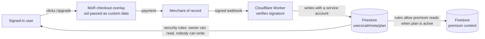

# Making PrepHub paid: plan

Status: proposal, nothing built. Written 2026-10-14. Fees and rules were checked that day in
secondary sources (links at the end); confirm them on each provider's own pricing page, and the
tax points with a Chartered Accountant, before choosing. This is not legal or tax advice.

## The constraint that decides everything

PrepHub is a static site whose source is a **public** GitHub repository. Every guide is a
markdown file in that repo and a JS chunk any visitor can download. So:

- **Content that already ships cannot be locked.** A paywall in the browser is decoration; the
  text is one "view source" away, and in the repo.
- **Only two things can really be paid for:** what is served from a server after checking a
  payment (account features, new content kept out of the public repo), and the convenience of
  supporting the author.
- Locking the existing library would mean moving all content to a private repo and a server,
  losing SEO and the offline PWA, and dropping the "free" promise the site is known for.

## Three models

| Model | What is paid | Effort | Revenue potential | Fit |
|---|---|---|---|---|
| **A. Supporters** | Nothing is locked. "Support PrepHub" via GitHub Sponsors / Buy Me a Coffee, with a supporter badge | 1 day | Low | Easiest; no tax setup beyond declaring income |
| **B. Freemium: free library + PrepHub Pro** (recommended) | Everything public stays free. Pro adds server-backed features and new premium content | 3–4 weeks | Medium | Keeps SEO and trust; uses the account work already built |
| **C. Full paywall** | All guides behind login | 6+ weeks, plus content migration | Unclear (SEO loss) | Not recommended |

### What Pro could contain (model B)

- **Progress sync across devices**: already built (`ACCOUNTS` flag). Free or Pro is a choice:
  making sync Pro-only is the cheapest Pro feature to ship.
- **Premium content packs**: *new* guides, company-specific question sets, extra challenges,
  written in a **private** repo and served from Firestore only to Pro accounts.
- **AI mock interviewer**: graded answers and feedback from an LLM. This has a real per-use cost,
  so it suits a paid tier (with a monthly usage cap).
- **Extras**: printable/PDF cheat sheets, interview-day study plans.

Suggested prices (to test, with lower prices in India): **$6/month, $39/year**, or
**₹299/month, ₹1,999/year** in India. A merchant of record (below) can set local prices per country.

## Taking payments from India

| Option | What it does | Fees (2026, secondary sources) | Tax work for you |
|---|---|---|---|
| **Merchant of record (MoR): Paddle, Lemon Squeezy** (recommended) | They are the legal seller. They charge the customer, collect and file VAT/GST/sales tax in every country, issue invoices, handle refunds and chargebacks, and pay you out | About **5% + $0.50** per sale, plus ~1.5–2% currency conversion | Small: you invoice the MoR, which counts as an export of services from India |
| **Razorpay** (direct gateway) | Charges cards and pays you; you are the seller | About **3% + 18% GST** on international cards, 1% export bank transfers, +~1% for subscriptions | Large: EU VAT on digital services applies to non-EU sellers from the **first** sale (VAT OSS registration), plus UK VAT, US state sales tax and GST in India |
| Stripe | Invite-only for new Indian accounts; Stripe's own MoR product reportedly not offered in India | — | — |

**Use a merchant of record.** For a solo developer selling digital subscriptions worldwide, the
extra ~2% buys freedom from registering for VAT and sales tax in dozens of places. Before
committing, confirm that the chosen MoR **onboards an individual or sole proprietor based in
India**, and its payout method (bank wire in USD, or via Payoneer or Wise).

## How it would work technically

- **Checkout**: the MoR's hosted overlay; the site stays static. The Firebase uid goes in as
  custom data so the payment can be tied to the account.
- **Webhook**: a **Cloudflare Worker** (free tier, your DNS is already on Cloudflare) verifies
  the MoR's signature and records the plan in Firestore through the REST API with a Google
  service account. (Alternative: a Firebase Cloud Function, which needs the Blaze plan; it is
  still pennies, with a budget alert.)
- **Entitlement**: `users/{uid}/meta/plan` = `{ status, renewsAt, provider }`. Security rules let
  the owner read it and let **no client write it**; only the Worker can.
- **Premium content**: written in a private repo, uploaded to Firestore by a script, readable
  only when the reader's plan is active (`firestore.rules` checks the plan document). It is
  cached on the device for offline use while the plan is active.
- **Cancellation and billing**: a "Manage subscription" link to the MoR's customer portal
  (cancel, change card, invoices). No card data ever touches PrepHub.
- **AI feature** (if chosen): the Worker calls the LLM API with a server-side key, checks the
  plan, and enforces a monthly cap per user. The key never reaches the browser.

## Legal and tax changes once money is involved

1. **Terms of Use**: price, billing period, **auto-renewal**, how to cancel, refund policy, and
   that content is provided as is. US state auto-renewal laws (California's in particular)
   require a clear renewal notice before purchase, the reader's consent to it, and **online
   cancellation as easy as sign-up**; the MoR portal provides that.
2. **EU 14-day right of withdrawal**: for digital content, it can be waived only if, at checkout,
   the buyer expressly asks for immediate access, **acknowledges losing the right**, and gets
   that confirmed by email. Subscriptions are a grey area, so a simple **14-day refund policy** is
   the safer and friendlier choice. Check how the MoR handles this; most do it for you.
3. **Privacy policy**: add the payment provider (MoR) as a separate controller or processor, what
   it receives, and the Worker (Cloudflare) as a processor for payment events.
4. **Germany (Impressum)**: a paid service is commercial, so §5 DDG likely applies to German
   customers: name, a **postal address** reachable for service, and email. A virtual business
   address avoids publishing your home address.
5. **India: tax**:
   - Income from Pro is business income, so file ITR-3 or ITR-4.
   - With an MoR, you sell to the MoR. That is usually an export of services: GST at zero rate
     under a **Letter of Undertaking (LUT)**, once you are GST-registered. Registration is
     mandatory above ₹20 lakh turnover, or earlier if you choose.
   - Without an MoR, sales to Indian consumers (OIDAR) and abroad get complicated quickly.
   - Confirm all of this with a CA, as well as foreign-inward-remittance paperwork (FIRA/FIRC).
6. **Consumer-protection basics**: show prices clearly with taxes, a cancel button, receipts
   (the MoR sends them), and a support email (already on the site).
7. **Accessibility**: the EU Accessibility Act microenterprise exemption still applies
   (fewer than 10 staff and ≤ €2M turnover).

## Costs

| Item | Cost |
|---|---|
| MoR fee | ~5% + $0.50 per sale (+ FX ~1.5–2%) |
| Cloudflare Worker (webhook) | $0 on the free tier at this scale |
| Firebase | Spark (free) still works with a Worker; Blaze only if Cloud Functions are used |
| AI mock interviewer (if built) | Per-use LLM cost; cap it per user per month |
| Virtual address for an Impressum | Optional, small monthly fee |
| CA for GST/LUT setup | One-off |

At $39/year after ~8% total fees, each yearly subscriber nets about **$36**.

## Phases

| Phase | Work | Time |
|---|---|---|
| 0. Decide | Model (A/B/C), what is in Pro, prices, MoR choice, CA consultation | You, ~1 week |
| 1. Accounts live | Turn on `ACCOUNTS`; run sync for real for a few weeks | Already built |
| 2. Entitlements | Worker + webhook verification, `meta/plan`, rules, `usePlan` hook, tests (signature forgery, replay, rules in the emulator) | 1 week |
| 3. Paywall UI | Pricing page, upgrade flow, Pro badges, "Manage subscription", cancellation | 1 week |
| 4. Premium content | Private content repo, upload script, rules-gated reads, offline cache | 1 week |
| 5. Legal | Terms (billing, renewal, refunds), privacy (MoR, Worker), Impressum, refund policy | 2–3 days |
| 6. Launch | Test mode end to end, a few real purchases with friends, then announce | 1 week |

Model A alone is a one-day job and can ship any time, even alongside model B.

## Decisions needed

1. **Model**: A (supporters), B (freemium Pro, recommended), or both?
2. **What goes in Pro**: sync, premium content packs, AI mock interviewer, PDFs?
3. **Prices**, and whether India gets local prices.
4. **Payment provider**: Paddle or Lemon Squeezy (confirm onboarding for an Indian individual),
   or Razorpay with your own tax registrations.
5. **Business setup**: sole proprietor vs a company, GST registration, an address for the
   Impressum. Ask a CA.

## Sources (checked 2026-10-14)

- Paddle fees: https://fungies.io/paddle-review-2026 and https://learnwithhasan.com/payment-gateways/paddle/
- Lemon Squeezy and Stripe Managed Payments: https://fungies.io/lemon-squeezy-stripe-acquisition-saas-founders-2026/ and https://dodopayments.com/blogs/stripe-managed-payments-fees-explained
- Stripe in India: https://www.skydo.com/blog/stripe-india-charges-review-alternatives
- Razorpay international fees: https://razorpay.com/blog/razorpay-payment-gateway-pricing-explained/ and https://www.xflowpay.com/blog/razorpay-international-payment-gateway-charges
- EU right of withdrawal for digital content: https://osborneclarke.com/insights/withdrawal-right
