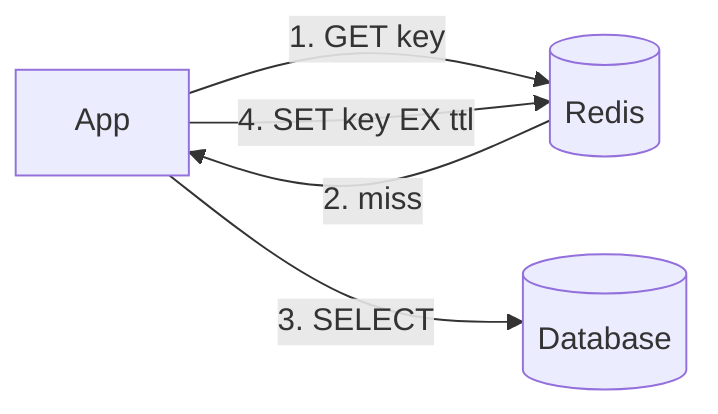

# Redis — Interview Guide

Redis is an in-memory data structure server: a key-value store where each value is a typed structure (a string, list, hash, set, sorted set, stream and more) that you change with atomic commands. It is the default answer for a cache, a rate limiter, a leaderboard, a session store, a lightweight queue and a distributed lock. Interviewers use it to test whether you know **what happens when memory runs out, when the process crashes, and when two clients race**.

The general caching theory (where a cache sits, multi-level caches, CDN headers) is in the [System Design guide](/system-design/guide#4-caching). This guide covers Redis itself. The three things that come up most: **eviction and expiry** (§3, §5), **persistence and what a crash loses** (§6), and **distributed locking** (§9).

## Table of Contents

1. [What Redis Is](#1-what-redis-is)
2. [Data Structures](#2-data-structures)
3. [Keys, Expiry and TTLs](#3-keys-expiry-and-ttls)
4. [Caching Strategies](#4-caching-strategies)
5. [Eviction Policies](#5-eviction-policies)
6. [Persistence: RDB and AOF](#6-persistence-rdb-and-aof)
7. [Transactions, Pipelining and Lua](#7-transactions-pipelining-and-lua)
8. [Pub/Sub and Streams](#8-pubsub-and-streams)
9. [Distributed Locking](#9-distributed-locking)
10. [Rate Limiting and Other Patterns](#10-rate-limiting-and-other-patterns)
11. [Replication, Sentinel and Cluster](#11-replication-sentinel-and-cluster)
12. [Performance Pitfalls](#12-performance-pitfalls)
13. [Redis vs Memcached vs Valkey](#13-redis-vs-memcached-vs-valkey)
14. [Interview Questions and Answers](#14-interview-questions-and-answers)
15. [Tricky Questions](#15-tricky-questions)
16. [Cheat Sheet](#16-cheat-sheet)
17. [References](#17-references)

---

## 1. What Redis Is

Redis keeps the whole dataset in RAM and runs every command on **one main thread**. Commands from all clients are queued and executed one at a time, so each command is atomic without locks: two clients running `INCR counter` at once can never lose an increment.

Why one thread is still fast:

- **No disk on the hot path.** A `GET` is a hash-table lookup in memory, typically well under a millisecond end to end, and most of that is network.
- **No lock contention.** There is nothing to lock because nothing runs in parallel on the data.
- **I/O threads.** Since Redis 6, reading from and writing to sockets can be spread over extra threads (`io-threads`), while command execution stays single-threaded. Background threads also handle `fsync`, freeing large values (`UNLINK`) and closing files.

The cost of that design: **one slow command blocks everyone**. `KEYS *` on ten million keys, `SMEMBERS` on a huge set or a long Lua script stops every other client until it finishes (§12).

> [!KEY]
> Redis is fast because it is in memory and runs commands on a single thread, so every command is atomic. The flip side is that any O(N) command on a big key stalls every client.

**Versions and licensing (as of November 2026).** Redis 7.4 (March 2024) moved from the BSD licence to a source-available dual licence (RSALv2/SSPLv1). The Linux Foundation forked the last BSD release as **Valkey**, which AWS, Google Cloud and others now offer. **Redis 8** (May 2025) added **AGPLv3** as a third licence option, so it is open source again, and it ships JSON, time series, probabilistic structures (Bloom filters and others), the query engine and the new vector sets inside the main distribution instead of as separate modules. For interview purposes Redis and Valkey behave the same for everything in this guide.

---

## 2. Data Structures

Every key holds exactly one type. Choosing the type is most of the design work, because the type decides which atomic operations you get.

| Type | What it is | Typical use | Key commands (cost) |
|---|---|---|---|
| String | Bytes up to 512 MB; also an integer or float counter | Cache entries, counters, flags, locks | `GET`/`SET` O(1), `INCR` O(1), `SETNX` |
| Hash | A map of field → value inside one key | An object (user profile), per-field updates | `HGET`/`HSET` O(1), `HGETALL` O(N) |
| List | A linked list of strings | Simple queues, recent-items feeds | `LPUSH`/`RPOP` O(1), `BRPOP` blocking, `LRANGE` O(S+N) |
| Set | Unordered unique strings | Tags, "who liked this", deduplication | `SADD`/`SISMEMBER` O(1), `SINTER` |
| Sorted set | Unique members, each with a float score, kept in score order | Leaderboards, priority queues, sliding-window rate limits, scheduling | `ZADD` O(log N), `ZRANGE` O(log N + M), `ZRANK` |
| Stream | An append-only log of entries with IDs, plus consumer groups | Durable event queues with acknowledgements | `XADD`, `XREADGROUP`, `XACK` |
| Bitmap | Bit operations on a string | Daily active users per user ID, feature flags | `SETBIT`, `BITCOUNT` |
| HyperLogLog | A probabilistic distinct counter in 12 KB | Unique visitors where ±0.81% is fine | `PFADD`, `PFCOUNT` |
| Geo | A sorted set of geohashed points | "Drivers within 2 km" | `GEOADD`, `GEOSEARCH` |

```text
SET page:home:views 0
INCR page:home:views                 # atomic counter
HSET user:42 name "Ada" plan "pro"   # one object, two fields
HINCRBY user:42 logins 1             # update one field without reading the rest
ZADD leaderboard 3200 "ada" 2900 "lin"
ZREVRANGE leaderboard 0 9 WITHSCORES # top 10, highest first
ZREVRANK leaderboard "lin"           # 0-based position from the top
```

**Small values are stored compactly.** A small hash, list or sorted set is stored as a *listpack* (one contiguous block of memory) and a set of small integers as an *intset*. Past a size threshold (`hash-max-listpack-entries` and similar settings) Redis converts it to a real hash table or skiplist. That is why a million small hashes use far less memory than a million separate string keys holding the same fields.

**Sorted sets** combine a hash table (member → score, for O(1) score lookup) with a **skiplist** (a linked list with express lanes, giving O(log N) insert and range queries). That pairing is the classic follow-up to "how would you build a leaderboard".

**Hash field expiry.** Since Redis 7.4 a single field inside a hash can have its own TTL (`HEXPIRE user:42 3600 FIELDS 1 session`). Before that, TTLs existed only on whole keys.

---

## 3. Keys, Expiry and TTLs

Any key can carry a time to live (TTL):

```text
SET session:abc "{...}" EX 1800        # set with a 30-minute TTL in one command
EXPIRE cart:42 600                     # add a TTL to an existing key
TTL cart:42                            # seconds left; -1 = no TTL, -2 = key missing
PERSIST cart:42                        # remove the TTL
SET otp:42 "731904" EX 300 NX          # only if absent, with a TTL, atomically
```

A plain `SET` **removes** an existing TTL unless you pass `KEEPTTL`. Overwriting a cached value with `SET key value` and forgetting the `EX` turns it into a key that never expires.

**How keys actually expire.** Redis does not run a timer per key. It uses two mechanisms:

1. **Lazy (passive) expiry**: when a client touches a key, Redis checks its TTL and deletes it if expired.
2. **Active expiry**: a background cycle (10 times a second by default) samples keys that have a TTL and deletes the expired ones. If many in the sample were expired, it samples again.

So an expired key that nobody reads can sit in memory for a while. Memory reports can include keys that are logically gone, and a sudden mass expiry costs CPU in the active cycle.

**Key naming.** Use colon-separated namespaces (`user:42:profile`, `rl:api:203.0.113.7`). It makes `SCAN MATCH user:*` possible and keeps keys readable in `redis-cli`. Keep names short when there are hundreds of millions of keys, because the key itself costs memory.

---

## 4. Caching Strategies

**Cache-aside (lazy loading)** is what most applications do: the app checks Redis, and on a miss reads the database and fills the cache.



```js
import Redis from 'ioredis';

const redis = new Redis(process.env.REDIS_URL);
// Stand-in for your real data layer.
const db = { findUser: async (id) => ({ id, name: 'Ada' }) };

async function getUser(id) {
  const key = `user:${id}`;
  const cached = await redis.get(key);
  if (cached !== null) return JSON.parse(cached);

  const user = await db.findUser(id);
  // Jitter the TTL so keys written together don't expire together.
  const ttl = 3600 + Math.floor(Math.random() * 300);
  await redis.set(key, JSON.stringify(user), 'EX', ttl);
  return user;
}

async function updateUserName(id, name) {
  // Write the database first, then delete (not update) the cache entry.
  // await db.updateUser(id, { name });
  await redis.del(`user:${id}`);
  return name;
}
```

| Strategy | How it works | Good for | Cost |
|---|---|---|---|
| Cache-aside | App reads cache, falls back to DB, fills cache | Read-heavy data, the default | First read is a miss; stale until TTL or invalidation |
| Read-through | The cache layer itself loads from the DB on a miss | Hiding loading logic in a library | Needs a cache that knows your DB |
| Write-through | Every write goes to cache and DB synchronously | Data read right after it is written | Slower writes; caches data nobody reads |
| Write-behind (write-back) | Write to cache, flush to DB asynchronously | Very write-heavy counters, metrics | Data loss if Redis dies before the flush |
| Refresh-ahead | Refresh hot keys before they expire | Hot keys with expensive loads | Wasted refreshes for keys that went cold |

**Why delete instead of update on write?** If two writers update the DB and then each `SET` the cache, the two cache writes can arrive in the opposite order and leave the older value cached forever. Deleting is idempotent, so order doesn't matter, and the next read reloads the truth. A smaller race remains: a reader misses, reads the *old* row, gets paused, the writer commits and deletes, then the reader `SET`s the stale value. A TTL bounds how long that lasts; a version number in the value, or invalidation driven by the database's change log (change data capture), closes it fully.

### The three classic cache failures

| Failure | What happens | Fixes |
|---|---|---|
| **Stampede** (also called breakdown, or dog-piling) | A hot key expires and thousands of requests miss at once and all hit the DB | Single-flight lock (`SET rebuild:key NX EX 10`) so one request rebuilds while others wait or serve stale; refresh early with probability rising near expiry; never expire hot keys and refresh them in the background |
| **Avalanche** | Many keys expire at the same moment (all set with the same TTL at deploy), or Redis restarts empty | TTL jitter, warm the cache gradually, a circuit breaker or rate limit in front of the DB, persistence or replicas so a restart isn't cold |
| **Penetration** | Requests for keys that exist in neither cache nor DB (bad IDs, an attacker) always miss | Cache the "not found" result with a short TTL; a Bloom filter of valid IDs in front; validate IDs at the edge |

> [!TRAP]
> Setting every cache key to exactly the same TTL (for example 3600 at warm-up) schedules an avalanche for one hour later. Always add random jitter to TTLs.

---

## 5. Eviction Policies

`maxmemory` caps how much memory Redis uses for data. When a write would exceed it, `maxmemory-policy` decides what happens:

| Policy | Evicts from | Picks |
|---|---|---|
| `noeviction` (the default) | Nothing | Rejects writes with an `OOM command not allowed` error; reads still work |
| `allkeys-lru` | All keys | Least recently used |
| `allkeys-lfu` | All keys | Least frequently used |
| `allkeys-random` | All keys | Random |
| `volatile-lru` | Only keys with a TTL | Least recently used |
| `volatile-lfu` | Only keys with a TTL | Least frequently used |
| `volatile-random` | Only keys with a TTL | Random |
| `volatile-ttl` | Only keys with a TTL | Shortest remaining TTL |

How to choose:

- **Pure cache:** `allkeys-lru`, or `allkeys-lfu` when a stable set of hot keys should survive a one-off scan of cold keys (LRU would let a single pass over cold keys push out the hot ones).
- **Cache plus data you must keep** (sessions, locks, queues) in the same instance: `volatile-lru`, and give only cache keys a TTL. Better still, use two instances.
- **Redis as a primary store or queue:** `noeviction`, plus memory alerts, because silently dropping a job is worse than a failed write.

**LRU in Redis is approximate.** Redis doesn't keep a global linked list of keys. On eviction it samples a few keys (`maxmemory-samples`, default 5) and evicts the best candidate from a small pool. Raising the sample size gets closer to true LRU for more CPU. **LFU** keeps a small logarithmic counter per key that decays over time, so a key that was hot yesterday cools down.

> [!TRAP]
> With a `volatile-*` policy, keys without a TTL are never evicted. If none of your keys has a TTL, Redis behaves exactly like `noeviction` and starts rejecting writes.

---

## 6. Persistence: RDB and AOF

Redis is in memory, but it can persist to disk so a restart doesn't start empty.

| Mechanism | How it works | What a crash loses | Trade-off |
|---|---|---|---|
| **RDB** (snapshots) | `BGSAVE` forks the process; the child writes a compact point-in-time file while the parent keeps serving | Everything since the last snapshot (minutes) | Small files, fast restarts, but the fork can pause a big instance |
| **AOF** (append-only file) | Every write command is appended to a log, replayed on restart | Depends on `appendfsync` (below) | Larger files, slower restart, much smaller loss window |
| Both (recommended for data you care about) | AOF for durability, RDB for backups | As AOF | More disk I/O |
| Neither | Pure cache | Everything | Fastest; fine when the DB is the source of truth |

`appendfsync` controls how often the AOF is flushed to the physical disk:

- `always`: fsync after every write. Safest and slowest.
- `everysec` (the default): fsync once a second in a background thread. A crash loses about a second of writes (up to two in the worst case).
- `no`: leave it to the OS, typically every 30 seconds on Linux.

The AOF grows forever, so Redis **rewrites** it in the background (`BGREWRITEAOF`) into the minimal set of commands that recreates the current data. Since Redis 7 the AOF is multi-part (a base file plus incremental files and a manifest), and the base is written in RDB format by default (`aof-use-rdb-preamble yes`) so restarts load faster.

**The fork is the operational hazard.** Forking a process with a 50 GB heap copies its page tables, which can stall Redis for tens or hundreds of milliseconds. After the fork, the OS shares memory pages *copy-on-write*: each page the parent modifies during the save gets copied. A write-heavy instance can briefly need close to **twice its memory**, which is how a Redis with `maxmemory` at 90% of the machine gets killed by the Linux OOM killer during a snapshot. Leave headroom, and disable transparent huge pages (they make every copied page 2 MB instead of 4 KB).

> [!FOLLOWUP]
> Is Redis with `appendfsync always` as durable as Postgres?
>
> On a single node it gets close for a crash of the process, but replication is asynchronous, so a failover can still lose writes the client was told succeeded (§11). Treat Redis as durable enough for data you could rebuild, not as the only copy of money or orders.

---

## 7. Transactions, Pipelining and Lua

**Pipelining** sends many commands without waiting for each reply, then reads all the replies. It removes round trips (100 commands in one round trip instead of 100). It is **not atomic**: other clients' commands can run between yours.

```js
import Redis from 'ioredis';

const redis = new Redis();

async function warmCounters(ids) {
  const pipe = redis.pipeline();
  for (const id of ids) pipe.set(`views:${id}`, 0, 'NX');
  return pipe.exec(); // one round trip; replies come back as [error, result] pairs
}
```

**`MULTI`/`EXEC` transactions** queue commands and run them as one block. No other client's command runs in the middle. But Redis transactions are **not like SQL transactions**:

- There is **no rollback**. If one queued command fails at run time (say `INCR` on a key that holds text), the others still run.
- A command that is wrong before it runs (a syntax error, a wrong number of arguments) makes `EXEC` abort the whole transaction.
- You cannot read a value and decide what to write *inside* `MULTI`, because replies only arrive at `EXEC`.

**`WATCH` adds optimistic locking** (check-and-set). `WATCH` a key, read it, then `MULTI ... EXEC`. If anyone changed the watched key in between, `EXEC` returns null and you retry.

```text
WATCH balance:42
GET balance:42                 # client reads 100, decides to subtract 30
MULTI
SET balance:42 70
EXEC                           # null if balance:42 changed since WATCH → retry
```

**Lua scripts** are the usual answer for "read, decide, write" atomically. A script runs on the server as one command: nothing else runs until it ends. Pass every key the script touches in `KEYS` (Redis Cluster uses them to route the script). Since Redis 7, **Functions** (`FUNCTION LOAD`, `FCALL`) are the persistent, named version of scripts, so you don't have to reload a script after a restart and handle `NOSCRIPT` errors for `EVALSHA`.

```lua
-- Atomically move stock from "available" to "reserved" only if enough is left.
-- KEYS[1] = stock hash, ARGV[1] = quantity
local available = tonumber(redis.call('HGET', KEYS[1], 'available') or '0')
local qty = tonumber(ARGV[1])
if available < qty then
  return 0
end
redis.call('HINCRBY', KEYS[1], 'available', -qty)
redis.call('HINCRBY', KEYS[1], 'reserved', qty)
return 1
```

Keep scripts short. A script that loops over a million elements blocks the server exactly like `KEYS *`, and the default `busy-reply-threshold` (5 seconds) only starts returning `BUSY` errors to other clients; it doesn't stop the script.

---

## 8. Pub/Sub and Streams

**Pub/Sub** is fire-and-forget broadcast. `PUBLISH channel msg` delivers to every client currently `SUBSCRIBE`d, and to nobody else.

- **At most once.** A subscriber that is disconnected, restarting or not yet subscribed simply misses the message. Nothing is stored.
- **Slow subscribers get cut off.** Messages buffer in the subscriber's output buffer; past `client-output-buffer-limit pubsub` (32 MB hard limit by default) Redis disconnects it.
- In Redis Cluster a classic `PUBLISH` is broadcast to every node. **Sharded Pub/Sub** (`SPUBLISH`/`SSUBSCRIBE`, Redis 7) keeps a channel on the shard that owns its slot, which scales much better.

Use it for things that are fine to lose: cache invalidation broadcasts, "something changed, refetch", fanning WebSocket messages across app servers (the [Real-Time Web guide](/frontend/realtime-web) shows that pattern).

**Streams** are the durable alternative: an append-only log inside a key, with consumer groups and acknowledgements, like a small Kafka topic with one partition.

```text
XADD orders * orderId 1001 total 49.90          # * = auto ID like 1731489600000-0
XGROUP CREATE orders billing $ MKSTREAM          # group starts at new entries
XREADGROUP GROUP billing worker-1 COUNT 10 BLOCK 5000 STREAMS orders >
XACK orders billing 1731489600000-0              # done; removes it from the pending list
XPENDING orders billing                          # delivered but not acknowledged
XAUTOCLAIM orders billing worker-2 60000 0       # take over entries idle > 60 s
XADD orders MAXLEN ~ 1000000 * ...              # cap the stream (approximate trim)
```

Each entry delivered to a consumer goes into the group's **pending entries list (PEL)** until it is `XACK`ed. If a worker crashes, its entries stay pending, and another worker claims them with `XAUTOCLAIM`. That gives **at-least-once** delivery, so consumers must be idempotent.

```js
import Redis from 'ioredis';

const redis = new Redis();

async function handle(fields) {
  // Stand-in for real work; must be safe to run twice for the same entry.
  return fields;
}

async function consume(consumerName) {
  for (;;) {
    const res = await redis.xreadgroup(
      'GROUP', 'billing', consumerName,
      'COUNT', 10, 'BLOCK', 5000,
      'STREAMS', 'orders', '>',
    );
    if (!res) continue; // BLOCK timed out with nothing new
    for (const [, entries] of res) {
      for (const [id, fields] of entries) {
        await handle(fields);
        await redis.xack('orders', 'billing', id);
      }
    }
  }
}
```

| Need | Use |
|---|---|
| Broadcast, losing a message is fine | Pub/Sub |
| Work queue, every job processed at least once, one service | Streams (or a list with `BLMOVE` for something simpler) |
| Many teams, long retention, replay, high throughput | A real broker, see the [Message Brokers guide](/backend/message-brokers) |

---

## 9. Distributed Locking

The single-instance lock is one command: set a key **only if it doesn't exist**, with an expiry so a crashed holder can't keep it forever, and a **random token** so you only ever release your own lock.

```text
SET lock:invoice:77 9f1c...e2 NX PX 30000     # OK = acquired, nil = someone else has it
```

Release must check the token and delete **atomically**, which needs a script:

```lua
-- KEYS[1] = lock key, ARGV[1] = this client's token
if redis.call('GET', KEYS[1]) == ARGV[1] then
  return redis.call('DEL', KEYS[1])
end
return 0
```

```js
import Redis from 'ioredis';
import { randomUUID } from 'node:crypto';

const redis = new Redis();
const RELEASE = `
if redis.call('GET', KEYS[1]) == ARGV[1] then
  return redis.call('DEL', KEYS[1])
end
return 0`;

async function withLock(resource, ttlMs, work) {
  const key = `lock:${resource}`;
  const token = randomUUID();
  const ok = await redis.set(key, token, 'PX', ttlMs, 'NX');
  if (ok !== 'OK') throw new Error(`${resource} is busy`);
  try {
    return await work();
  } finally {
    await redis.eval(RELEASE, 1, key, token);
  }
}
```

Why each part matters:

- **`NX`**: without it, the second client overwrites the first one's lock.
- **The expiry (`PX`)**: without it, a client that crashes holds the lock forever.
- **`SET ... NX PX` in one command**: `SETNX` then `EXPIRE` as two commands leaves a lock with no expiry if the client dies between them.
- **The token check on release**: if your work outlives the TTL, the lock expires and client B acquires it. A plain `DEL` would then delete **B's** lock.

**Redlock** is the multi-node algorithm: acquire the same lock on a majority of N independent Redis masters (usually 5) within a time budget, and treat the lock as valid only for the TTL minus the time spent. It survives one Redis node failing.

**The critique (Martin Kleppmann's).** No lock with a timeout can guarantee mutual exclusion by itself. A client can be paused (a long garbage-collection pause, a VM migration) past its TTL, wake up, and still believe it holds the lock while another client does too. Redlock also assumes clocks behave. The fix is a **fencing token**: a number that increases every time the lock is granted, sent with every write, and rejected by the storage if it has already seen a higher one. Redis locks don't produce such a number on their own.

> [!KEY]
> A Redis lock is fine for **efficiency** (avoid doing the same work twice; a rare duplicate is harmless). For **correctness** (two holders would corrupt data), use fencing tokens checked by the storage, or a consensus system such as etcd or ZooKeeper, or a database row lock.

---

## 10. Rate Limiting and Other Patterns

**Fixed window**: one counter per client per minute. Simple and cheap; allows a burst of up to 2× the limit across a window boundary.

```text
INCR rl:203.0.113.7:2026-11-13T10:41      # returns the count in this minute
EXPIRE rl:203.0.113.7:2026-11-13T10:41 60 NX
```

**Sliding window log**: a sorted set of request timestamps per client. Exact, but memory grows with the limit.

```text
MULTI
ZREMRANGEBYSCORE rl:user:42 0 1731494400000      # drop entries older than now - 60 s
ZADD rl:user:42 1731494460000 1731494460000-8f3a # member must be unique per request
ZCARD rl:user:42                                 # count after adding
PEXPIRE rl:user:42 60000
EXEC
```

**Token bucket** in Lua: the bucket refills continuously and each request spends a token. It allows controlled bursts and is what most API gateways implement.

```lua
-- KEYS[1] = bucket; ARGV[1] = capacity, ARGV[2] = tokens per second
local capacity = tonumber(ARGV[1])
local rate = tonumber(ARGV[2])
local t = redis.call('TIME')
local now = tonumber(t[1]) * 1000 + math.floor(tonumber(t[2]) / 1000)
local state = redis.call('HMGET', KEYS[1], 'tokens', 'ts')
local tokens = tonumber(state[1]) or capacity
local ts = tonumber(state[2]) or now
tokens = math.min(capacity, tokens + (now - ts) / 1000 * rate)
local allowed = 0
if tokens >= 1 then
  tokens = tokens - 1
  allowed = 1
end
redis.call('HSET', KEYS[1], 'tokens', tokens, 'ts', now)
redis.call('PEXPIRE', KEYS[1], math.ceil(capacity / rate * 1000))
return allowed
```

The script reads the clock with `TIME` on the server, so app servers with drifting clocks share one timeline.

Other patterns interviewers like:

- **Leaderboard**: a sorted set; `ZINCRBY` on each score, `ZREVRANGE 0 9` for the top 10, `ZREVRANK` for "your position".
- **Session store**: a hash per session with a TTL refreshed on activity, shared by all app servers.
- **Idempotency keys**: `SET idem:<key> <response> NX EX 86400` before processing a payment request; a retry with the same key returns the stored response.
- **Unique counts**: `PFADD`/`PFCOUNT` (HyperLogLog) for "unique visitors today" in 12 KB per counter.
- **Delayed jobs**: a sorted set scored by run-at time; workers poll `ZRANGEBYSCORE jobs 0 <now>` and claim jobs with a script.

---

## 11. Replication, Sentinel and Cluster

**Replication** is primary → replicas, **asynchronous**. The primary acknowledges a write to the client before replicas have it. Replicas serve reads (which may be slightly stale) and are the failover target. `WAIT 1 100` blocks until at least one replica has the write, which narrows the loss window but doesn't make failover lossless.

**Sentinel** is the high-availability layer for a single primary: a group of Sentinel processes monitors the primary, agrees (by a quorum) that it is down, promotes a replica and tells clients the new address. Clients ask Sentinel "who is the primary for `mymaster`?" instead of hard-coding a host.

**Redis Cluster** shards data across several primaries, each with replicas:

- The keyspace is split into **16,384 hash slots**. A key's slot is `CRC16(key) mod 16384`, and each primary owns a range of slots.
- A client that sends a command to the wrong node gets `MOVED <slot> <host:port>` and updates its slot map. During resharding it can get `ASK`, a one-time redirect for a slot in the middle of moving.
- **Multi-key commands** (`MGET`, `MULTI`, Lua scripts) work only if every key is in the same slot; otherwise you get a `CROSSSLOT` error.
- **Hash tags** force keys into one slot: only the part inside `{}` is hashed, so `{user:42}:cart` and `{user:42}:profile` land together.
- Cluster supports only database 0, and failover is automatic (replicas of a failed primary hold an election).

| Setup | Scales writes | Automatic failover | Multi-key operations |
|---|---|---|---|
| Single node | No | No | All |
| Primary + replicas + Sentinel | No (reads only) | Yes | All |
| Redis Cluster | Yes | Yes | Same slot only (hash tags) |

> [!TRAP]
> Putting every key under one hash tag, such as `{app}:...`, makes all multi-key commands work and silently puts the whole dataset on one shard. Hash-tag by the entity (user, tenant, order), not by the application.

---

## 12. Performance Pitfalls

| Pitfall | Why it hurts | Instead |
|---|---|---|
| `KEYS pattern` in production | O(N) over every key; blocks the server for seconds | `SCAN` with a cursor (it may return a key twice, so dedupe) |
| Big keys (a hash with 5 million fields, a 100 MB string) | Every read of it is slow, `DEL` blocks, and its shard is hot in Cluster | Split it (`user:42:events:2026-11`), or read with `HSCAN`/`ZSCAN` |
| `DEL` on a big key | Freeing millions of elements runs on the main thread | `UNLINK` frees in a background thread |
| `HGETALL`/`SMEMBERS`/`LRANGE 0 -1` on large collections | Returns everything; O(N) on the server and the network | Page with `HSCAN`/`SSCAN`/`LRANGE` slices |
| Hot keys | One key on one shard gets most of the traffic | Local in-process cache in front, or copies of the key (`hot:1`…`hot:8`) read at random |
| A new connection per request | TCP and TLS handshakes cost far more than the command | One long-lived client per process (Redis clients multiplex) |
| Round trips in a loop | 1,000 `GET`s = 1,000 round trips | `MGET`, pipelining |
| `maxmemory` close to the machine's RAM | Fork for RDB/AOF rewrite needs extra memory; OOM kill | Leave 30-50% headroom on write-heavy instances |

Diagnosis tools: `SLOWLOG GET` (commands over `slowlog-log-slower-than`, 10 ms by default), `LATENCY DOCTOR`, `INFO memory` (`used_memory` vs `used_memory_rss` shows fragmentation), `MEMORY USAGE key`, and `redis-cli --bigkeys` / `--memkeys` / `--hotkeys` (the last needs an LFU policy).

**Memory fragmentation.** After you delete many keys, the operating system may still show the old resident size (RSS), because freed memory sits in the allocator's free lists. `mem_fragmentation_ratio` well above 1.5 means fragmentation; `activedefrag yes` compacts it in the background.

---

## 13. Redis vs Memcached vs Valkey

| Aspect | Redis | Memcached | Valkey |
|---|---|---|---|
| Data model | Typed structures (hash, sorted set, stream…) | Opaque strings only | Same as Redis |
| Threads | Single command thread + I/O threads | Multi-threaded | Single command thread, more aggressive I/O threading |
| Persistence | RDB, AOF | None | RDB, AOF |
| Replication and failover | Replicas, Sentinel, Cluster | None built in (client-side sharding) | Same as Redis |
| Pub/Sub, streams, Lua | Yes | No | Yes |
| Licence | RSALv2/SSPLv1, and AGPLv3 from Redis 8 | BSD | BSD |

Choose **Memcached** only for a plain, large, multi-threaded string cache where you need nothing else. Choose **Redis or Valkey** for everything in this guide. Between those two the decision is licensing and which one your cloud provider runs (the major clouds offer Valkey as a managed service), not features you use in an interview answer.

**Redis is not your database** unless you've designed for it: memory is expensive, replication is asynchronous, and there are no ad-hoc queries or joins. Keep the source of truth in a database and treat Redis as something you can rebuild.

---

## 14. Interview Questions and Answers

**Q1: Why is Redis so fast if it runs commands on a single thread?**

Because the work per command is tiny and nothing slows it down: the data is in RAM, so a `GET` is a hash-table lookup with no disk access; one thread means no locks and no contention between threads; and Redis uses non-blocking I/O multiplexing (`epoll`) so one thread can serve thousands of connections. Since Redis 6, socket reads and writes can also run on I/O threads while commands still execute on one thread. The bottleneck is usually the network or memory, not the CPU. The same design is the weakness: an O(N) command on a large key, or a long Lua script, blocks every other client, because there is only one thread to run commands.

**Q2: Explain cache-aside, write-through and write-behind, and which you'd pick for a user profile.**

Cache-aside: the application reads Redis, on a miss loads the database and writes the result to Redis with a TTL; on update it writes the database and deletes the cache key. Write-through: every write updates both the cache and the database synchronously, so reads right after writes hit the cache. Write-behind: writes go to the cache and are flushed to the database later, giving fast writes but losing data if the cache dies first. For a user profile, which is read far more than written, cache-aside with delete-on-write and a TTL is the right default: it only caches profiles that are actually read, and the TTL bounds staleness if an invalidation is missed.

**Q3: What are cache stampede, avalanche and penetration, and how do you prevent each?**

A stampede is a hot key expiring so thousands of concurrent requests miss together and all query the database; prevent it with a single-flight rebuild lock (`SET rebuild:key NX EX 10`) while others serve the stale value, probabilistic early refresh, or never expiring hot keys and refreshing them in the background. An avalanche is many keys expiring at once, typically because they were written together with the same TTL, or the cache restarting empty; prevent it with TTL jitter, gradual warm-up and a rate limit or circuit breaker in front of the database. Penetration is requests for keys that exist nowhere, so every one misses; prevent it by caching "not found" with a short TTL and putting a Bloom filter of valid IDs in front of the cache.

**Q4: Compare the eviction policies. Which would you use for a cache, and what is the default?**

The default is `noeviction`: once `maxmemory` is reached, writes fail with an OOM error and nothing is evicted. `allkeys-lru` and `allkeys-lfu` evict any key by recency or frequency; `volatile-lru`, `volatile-lfu`, `volatile-random` and `volatile-ttl` evict only keys that have a TTL; `allkeys-random` evicts any key at random. For a pure cache use `allkeys-lru`, or `allkeys-lfu` when a stable hot set should survive a scan over cold keys. If the instance also stores data you can't lose, use `volatile-lru` with TTLs only on cache keys, or better, separate instances. Redis's LRU is approximate: it samples `maxmemory-samples` keys (5 by default) instead of tracking exact order.

**Q5: How does Redis persist data, and what can a crash lose?**

RDB writes point-in-time snapshots by forking; a crash loses everything since the last snapshot, which can be minutes. AOF appends every write command to a log and replays it on restart; with the default `appendfsync everysec` a crash loses about one second of writes, with `always` almost nothing at the cost of write speed. Production setups that care about the data run both: AOF for a small loss window, RDB files for backups. The AOF is compacted in the background by rewriting it, and since Redis 7 it is split into a base file and incremental files. Persistence only protects one node: replication is asynchronous, so a failover can lose acknowledged writes no matter what `appendfsync` says.

**Q6: Are Redis transactions ACID? What do `MULTI`, `EXEC` and `WATCH` actually guarantee?**

They give isolation and atomic execution but not rollback. Commands queued after `MULTI` run together at `EXEC` with no other client's command interleaved. If a command fails at run time, for example `INCR` on a non-numeric string, the others still execute and nothing is rolled back; only an error detected while queueing (bad syntax) aborts the whole transaction. You cannot branch on a read inside `MULTI`, because replies arrive only at `EXEC`. `WATCH` adds optimistic concurrency: if a watched key changes before `EXEC`, the transaction returns null and the client retries. For real read-decide-write logic, a Lua script or Function is simpler, because it runs atomically and can branch.

**Q7: When would you use a Lua script instead of `MULTI`/`EXEC`?**

When the write depends on a value you read, such as "reserve stock only if enough is available" or a token-bucket rate limiter. A script runs on the server as a single atomic command, so it can read, branch and write without another client running in between, and it saves round trips. Every key it touches must be passed in `KEYS` so Redis Cluster can route it, and all those keys must be in one slot. Scripts must stay short, because they block the single command thread. Since Redis 7, Functions (`FUNCTION LOAD` + `FCALL`) are the managed form: named, persisted and replicated, so you don't have to reload them after a restart.

**Q8: How do you implement a distributed lock with Redis, and what are its limits?**

Acquire with `SET lock:resource <random-token> NX PX 30000` in one command: `NX` makes it exclusive, the expiry frees it if the holder crashes, and the random token identifies the owner. Release with a Lua script that deletes the key only if it still holds your token, so a client whose lock already expired can't delete someone else's. Redlock extends this to a majority of five independent masters to survive a node failure. The limit is that any lease-based lock can be held by two clients at once if the holder pauses past its TTL (garbage collection, VM migration), and Redlock relies on reasonable clocks. So a Redis lock is fine to avoid duplicate work; when a double holder would corrupt data, use fencing tokens checked by the storage, or a consensus store like etcd or ZooKeeper.

**Q9: Pub/Sub or Streams for a job queue?**

Streams. Pub/Sub keeps nothing: a subscriber that is offline or restarting misses every message, and slow subscribers are disconnected when their output buffer fills, so it is at-most-once. Streams persist entries in a log, support consumer groups so several workers share the work, track delivered-but-unacknowledged entries in a pending entries list, and let another worker take over a crashed worker's entries with `XAUTOCLAIM`. That gives at-least-once delivery, so the handler must be idempotent. Pub/Sub is right for broadcasts you can afford to lose, such as cache-invalidation hints or fanning WebSocket messages across servers.

**Q10: How does Redis Cluster distribute keys, and what breaks when you move from a single node to Cluster?**

Keys map to one of 16,384 hash slots by `CRC16(key) mod 16384`, and each primary owns a range of slots; clients cache the slot map and follow `MOVED` (slot moved for good) and `ASK` (slot being migrated) redirects. What breaks: multi-key commands, transactions and Lua scripts fail with `CROSSSLOT` unless all keys are in the same slot, only database 0 exists, and a classic `PUBLISH` is broadcast to every node. The fix for multi-key operations is hash tags: only the part in `{}` is hashed, so `{user:42}:cart` and `{user:42}:profile` share a slot. Tag by entity, not by application, or one shard ends up with everything.

**Q11: What happens to writes during a Redis failover?**

They can be lost. Replication is asynchronous: the primary replies OK before the replica has the write. If the primary dies, Sentinel or Cluster promotes a replica that may be missing the last writes, and those acknowledged writes are gone. A network partition makes it worse: a primary isolated with a minority of clients keeps accepting writes until it notices (`min-replicas-to-write` limits this) and those are discarded when it rejoins as a replica. `WAIT` narrows the window by blocking until N replicas have the write, but it is not a consensus protocol. That is why Redis should hold data you can rebuild or tolerate losing a little of.

**Q12: How would you build a leaderboard for millions of players?**

A sorted set with the player ID as member and score as score: `ZINCRBY leaderboard 50 player:42` on each game, `ZREVRANGE leaderboard 0 9 WITHSCORES` for the top 10, `ZREVRANK` and `ZSCORE` for a player's own rank and score, all O(log N) because a sorted set is a skiplist plus a hash table. For time-boxed boards, use one key per period (`leaderboard:2026-w46`) with a TTL. To break ties by who got there first, encode time into the score (for example a fractional part that decreases with time). With hundreds of millions of members, one key becomes a big, hot key on one shard, so split by region or bucket and merge the top N of each bucket.

**Q13: How do you find what is making Redis slow?**

Check `SLOWLOG GET` for commands over the threshold (often `KEYS`, `HGETALL`/`SMEMBERS` on large collections, `DEL` of big keys or long Lua scripts), `LATENCY DOCTOR` for latency spikes such as forks for RDB or AOF rewrites, and `INFO` for memory, fragmentation, evictions, connected clients and blocked clients. `redis-cli --bigkeys` and `--memkeys` find oversized keys, and `--hotkeys` (with an LFU policy) finds hot ones. On the client side, look for a new connection per request, missing pipelining (a loop of single `GET`s) and network round-trip time, which usually dominates a sub-millisecond command.

**Q14: When should you not use Redis?**

When it would be the only copy of data you can't lose, such as payments or orders: replication is asynchronous and memory is far more expensive than disk. When you need ad-hoc queries, joins or secondary indexes over a large dataset (the query engine in Redis 8 helps, but a database is the better home). When the dataset is far larger than RAM. And as a message broker for many independent teams that need long retention and replay; Kafka or RabbitMQ fit that better. Redis shines as a fast, rebuildable layer in front of a real database, and for coordination primitives such as counters, rate limits and short leases.

---

## 15. Tricky Questions

**Q1: You set `maxmemory 4gb` on a cache. When memory fills up, writes fail with `OOM command not allowed` instead of evicting old keys. Why?**

The default `maxmemory-policy` is `noeviction`, which never evicts: it rejects writes once the limit is reached and keeps serving reads. Setting `maxmemory` alone only adds the limit. The other way to hit this is a `volatile-*` policy (`volatile-lru`, `volatile-ttl`…) when your keys have no TTL: those policies only consider keys with an expiry, so with none to choose from they behave like `noeviction`. For a cache, set `maxmemory-policy allkeys-lru` (or `allkeys-lfu`).

**Q2: A job takes a lock with `SET lock:report 1 NX EX 30`, does the work, and calls `DEL lock:report` in a `finally`. Occasionally two jobs run at once. What is wrong?**

The lock value is the constant `1`, so release can't tell whose lock it is. When a job runs longer than 30 seconds, the lock expires, job B acquires it, and then job A finishes and its `DEL` deletes **B's** lock, so job C can acquire it while B is still running. Store a random token per acquisition and release with a Lua script that deletes only if the value still equals your token. That fixes the wrong-owner delete; the overrun itself still means two jobs overlapped, so either extend the lock while working or protect the side effect with a fencing token.

**Q3: Inside `MULTI`, you queue `SET a 1`, `INCR name` (where `name` holds "Ada") and `SET b 2`. What does `EXEC` do?**

`EXEC` runs all three and returns three replies: `OK`, an error (`ERR value is not an integer or out of range`) and `OK`. Keys `a` and `b` are set; nothing is rolled back. Redis transactions guarantee that the queued commands run together without interleaving, not that they all succeed or all fail. Only errors detected while queueing, such as a misspelled command or the wrong number of arguments, make `EXEC` abort with `EXECABORT` and run nothing.

**Q4: Someone ran `KEYS session:*` in production to count sessions, and every API call timed out for four seconds. Why, and what should they have run?**

`KEYS` walks the entire keyspace in one command, and Redis runs commands on a single thread, so for those seconds no other client's command ran. `SCAN 0 MATCH session:* COUNT 1000` does the same walk in small steps with a cursor, interleaving with other traffic (a key can appear twice, so dedupe). Better still, don't scan to count: keep a counter, or a set of active session IDs, updated when sessions are created and expire. Production instances often rename or disable `KEYS` through ACLs for this reason.

**Q5: The client got `OK` for a write, the primary crashed a moment later, and after failover the write is gone even though AOF uses `appendfsync always`. How?**

The AOF settings protect the primary's own disk; they say nothing about the replica. Replication is asynchronous, so the primary acknowledged the write before shipping it, and the replica that was promoted never received it. When the old primary comes back it rejoins as a replica and resyncs from the new primary, discarding its copy. `WAIT 1 <timeout>` after important writes narrows the window, and `min-replicas-to-write` stops an isolated primary accepting writes, but Redis has no consensus-based replication, so treat recent writes as losable.

**Q6: After moving to Redis Cluster, `MGET user:1:name user:2:name` fails with `CROSSSLOT`. A teammate fixes it by renaming every key to `{users}:1:name`. What's the new problem?**

The `CROSSSLOT` error is gone because every key now hashes on the tag `users` and lands in the same slot, but that also means **every user key lives on one shard**. That shard holds the whole dataset and takes all the traffic, so the cluster no longer scales and that node runs out of memory first. Hash tags should group keys that are used together for one entity, like `{user:1}:name` and `{user:1}:email`. For data spread over many users, issue the reads per slot (most cluster clients split `MGET` by slot for you) instead of forcing one slot.

**Q7: You `DEL` 20 GB of keys, `used_memory` drops, but the server's RSS (resident memory) stays at 30 GB. Is Redis leaking?**

No. Redis returned the memory to its allocator (jemalloc), but the allocator keeps freed pages in its free lists and fragmented pages can't be handed back to the OS while a few live allocations remain on them. `INFO memory` shows this as a high `mem_fragmentation_ratio` (`used_memory_rss` / `used_memory`). The space is reused for new writes, so it isn't lost. To shrink RSS, enable `activedefrag yes` so Redis moves allocations together in the background, or restart a replica and fail over to it. Use `UNLINK` instead of `DEL` for big keys so the freeing happens off the main thread.

**Q8: A service publishes `order-paid` events with `PUBLISH`. The email worker was redeployed for 20 seconds, and the customers who paid in that window never got a receipt. Why?**

Pub/Sub only delivers to clients subscribed at the moment of `PUBLISH`, and stores nothing. While the worker was restarting there were no subscribers on that channel, so the messages went to nobody. Nothing will ever replay them. Use a Stream with a consumer group (`XADD`, `XREADGROUP`, `XACK`): entries are kept, the worker resumes from where its group left off after restarting, and unacknowledged entries can be claimed by another worker. For events that several services depend on, a broker such as Kafka is the usual choice.

**Q9: Cache hit rate is 98% all day, but every day at 03:00 the database spikes to 100% CPU for a minute. The nightly job rebuilds the cache at 02:00. What's going on?**

The nightly job writes every key at about the same time with the same TTL (an hour), so at about 03:00 they all expire together and almost every request misses at once: a cache avalanche. Add random jitter to each TTL (for example 3600 + random 0–600 seconds) so expiries spread out, and protect the hottest keys from a stampede with a single-flight rebuild lock or by refreshing them before they expire. Rate limiting the cache-miss path in front of the database stops one bad minute from becoming an outage.

**Q10: A sliding-window rate limiter does `ZADD rl:user:42 <now-ms> <now-ms>` per request. Under load, users get more requests through than the limit. Why?**

Sorted-set members are unique. Two requests in the same millisecond add the same member twice, the second `ZADD` just updates the existing member's score, and `ZCARD` counts one request instead of two. Make each member unique, such as `<now-ms>-<random or request ID>`, and keep the score as the timestamp. Also run the trim, add and count in one `MULTI` or Lua script, so two concurrent requests can't both read a count under the limit.

---

## 16. Cheat Sheet

**Core**

1. In memory, one command thread: every command is atomic; any O(N) command blocks everyone.
2. Choose the data type for the atomic operations you need (hash for objects, sorted set for rankings and windows, stream for durable queues).
3. A `SET` without `KEEPTTL` drops the existing TTL.
4. Expiry is lazy on access plus an active sampling cycle; expired keys can linger.
5. Hash field TTLs exist since 7.4 (`HEXPIRE`).

**Caching**

6. Cache-aside is the default: read cache, load DB on miss, delete the key on write.
7. Delete, don't update, the cache on writes; TTL bounds any remaining race.
8. Jitter TTLs (avalanche), single-flight rebuilds (stampede), cache "not found" + Bloom filter (penetration).

**Memory**

9. Default `maxmemory-policy` is `noeviction`: writes fail at the limit.
10. Pure cache: `allkeys-lru` or `allkeys-lfu`.
11. `volatile-*` with no TTL keys = `noeviction`.
12. LRU is approximate (`maxmemory-samples`, default 5).
13. Leave headroom: a fork for persistence can need up to 2× memory on a write-heavy instance.

**Persistence**

14. RDB: snapshots via fork; loses minutes.
15. AOF `everysec` (default): loses about a second; `always`: about nothing, slower.
16. Persistence doesn't survive failover loss: replication is asynchronous.

**Atomicity**

17. Pipelining saves round trips, not atomic.
18. `MULTI`/`EXEC`: no interleaving, no rollback. `WATCH` = optimistic retry.
19. Lua scripts and Functions: atomic read-decide-write; keys in `KEYS`; keep them short.

**Messaging**

20. Pub/Sub: at-most-once, nothing stored.
21. Streams: consumer groups, PEL, `XACK`, `XAUTOCLAIM`: at-least-once.

**Locks**

22. `SET key token NX PX ttl`; release with a compare-and-delete script.
23. Redlock = majority of 5 masters; still no fencing.
24. Locks for efficiency OK; for correctness add fencing tokens or use etcd/ZooKeeper/DB locks.

**Scaling**

25. Cluster: 16,384 slots, `CRC16(key) mod 16384`, `MOVED`/`ASK`.
26. Multi-key ops need one slot: hash tags `{entity}`, never one global tag.
27. Sentinel = failover for one primary; Cluster = sharding + failover.

**Operations**

28. `SCAN`, never `KEYS`; `UNLINK`, not `DEL`, for big keys.
29. `SLOWLOG`, `LATENCY DOCTOR`, `INFO memory`, `--bigkeys`, `--hotkeys`.
30. One long-lived client per process; pipeline or `MGET` loops.

---

## 17. References

- [Redis documentation](https://redis.io/docs/latest/) — commands, data types and operations.
- [Key eviction](https://redis.io/docs/latest/develop/reference/eviction/) and [Redis persistence](https://redis.io/docs/latest/operate/oss_and_stack/management/persistence/)
- [Transactions](https://redis.io/docs/latest/develop/interact/transactions/) and [Scripting with Lua](https://redis.io/docs/latest/develop/interact/programmability/eval-intro/)
- [Redis Streams](https://redis.io/docs/latest/develop/data-types/streams/)
- [Distributed locks with Redis (Redlock)](https://redis.io/docs/latest/develop/use/patterns/distributed-locks/)
- [How to do distributed locking](https://martin.kleppmann.com/2016/02/08/how-to-do-distributed-locking.html) — Martin Kleppmann's critique and fencing tokens.
- [Redis Cluster specification](https://redis.io/docs/latest/operate/oss_and_stack/reference/cluster-spec/)
- [Valkey](https://valkey.io/) — the BSD-licensed fork.
