# HTML — Complete Guide

HTML is the part of the frontend that everyone assumes they know, which is exactly why it gets asked. The questions are rarely "what does `<p>` do?". They are "why did your `<div>` end up outside the `<p>` you put it in?", "why does this button submit the form?", "why does `getAttribute('value')` still say the old value?", and "what changes if this script is `defer`?". Each has a precise answer in the HTML Living Standard, and each is a bug you will eventually ship if you don't know it.

This guide covers the document, the parser, semantics, forms, attributes, script loading, media, templates and web components, metadata and safety. Styling is in [CSS Fundamentals](/frontend/css-fundamentals) and [Modern CSS](/frontend/modern-css); assistive technology in depth is in [Accessibility](/frontend/accessibility).

---

## Table of Contents

- [1. How the Browser Reads HTML](#1-how-the-browser-reads-html)
- [2. The Document and the head](#2-the-document-and-the-head)
- [3. Semantic Elements](#3-semantic-elements)
- [4. Text-Level Semantics](#4-text-level-semantics)
- [5. Links](#5-links)
- [6. Images and Media](#6-images-and-media)
- [7. Forms](#7-forms)
- [8. Attributes and Properties](#8-attributes-and-properties)
- [9. Loading Scripts and Styles](#9-loading-scripts-and-styles)
- [10. Tables](#10-tables)
- [11. Built-in Interactive Elements](#11-built-in-interactive-elements)
- [12. iframes and Embedding](#12-iframes-and-embedding)
- [13. Templates and Web Components](#13-templates-and-web-components)
- [14. Metadata for Search and Sharing](#14-metadata-for-search-and-sharing)
- [15. HTML and Security](#15-html-and-security)
- [16. Interview Questions & Answers](#16-interview-questions-answers)
- [17. Tricky Questions](#17-tricky-questions)
- [18. Cheat Sheet](#18-cheat-sheet)
- [19. References](#19-references)

---

## 1. How the Browser Reads HTML

The browser turns bytes into a **DOM** (Document Object Model: the tree of objects that JavaScript and CSS work with) in a fixed pipeline:

```text
bytes → characters (decoding, using the charset) → tokens (start tag, end tag, text, comment)
      → tree construction (the DOM) → style → layout → paint
```

Three facts about that pipeline explain most HTML interview questions.

**The parser never fails.** XML stops at the first error; HTML has a fully specified error-recovery algorithm, so every browser builds the *same* tree from the same broken markup. That is why `<p>one<p>two` gives two paragraphs, and why a `<div>` inside a `<p>` ends up beside it (the parser closes the open `<p>` first, see [Tricky Q1](#17-tricky-questions)). Invalid HTML is never an error you see; it is a tree you didn't expect.

**Some end tags are optional, some elements have none.** `</p>`, `</li>`, `</td>`, `</tr>`, `</option>` and even `</body>` and `</html>` can be omitted, because the parser infers them. **Void elements** (``, `<input>`, `<br>`, `<meta>`, `<link>`, `<hr>`, `<source>`) have no content and no end tag. The trailing slash in `<br />` is allowed and ignored. On a non-void element it is ignored too: `<div />` is a start tag, so everything after it goes inside the div ([Tricky Q2](#17-tricky-questions)).

**Parsing is incremental and scripts interrupt it.** The parser streams; it doesn't wait for the whole file. A plain `<script>` stops parsing until it has downloaded and run, because the script could call `document.write()` and change what comes next. That single fact is the reason `defer`, `async` and `type="module"` exist ([§9](#9-loading-scripts-and-styles)).

### DOCTYPE and quirks mode

`<!DOCTYPE html>` has one job: it puts the page in **standards mode**. Without it, browsers use **quirks mode**, which emulates late-1990s rendering bugs so that very old pages still look as their authors saw them. In quirks mode, for example, percentage heights resolve against the viewport in more cases and tables don't inherit font size. There is also a near-standards ("limited quirks") mode triggered by some legacy doctypes. The modern doctype is short because its only purpose is to avoid quirks; it no longer references a DTD (a Document Type Definition, the grammar file older SGML-based HTML versions pointed to).

```html
<script>
  console.log(document.compatMode); // "CSS1Compat" = standards, "BackCompat" = quirks
</script>
```

---

## 2. The Document and the head

```html
<!DOCTYPE html>
<html lang="en">
  <head>
    <meta charset="utf-8">
    <meta name="viewport" content="width=device-width, initial-scale=1">
    <title>Order #1042 · Acme</title>
    <meta name="description" content="Track and manage order #1042.">
    <link rel="icon" href="/favicon.svg" type="image/svg+xml">
    <link rel="stylesheet" href="/app.css">
    <script src="/app.js" defer></script>
  </head>
  <body>
    …
  </body>
</html>
```

What each line is for, and what goes wrong without it:

| Element | What it does | Without it |
|---|---|---|
| `lang="en"` | Declares the language of the content | Screen readers pick the wrong pronunciation; translation tools and hyphenation guess |
| `<meta charset="utf-8">` | Tells the decoder how to read bytes. Must be in the first 1024 bytes | Characters like `é` or `€` can render as `é` (mojibake, text decoded with the wrong encoding) |
| `viewport` meta | Makes the layout viewport equal to the device width | Mobile browsers render at ~980 px and zoom out, so media queries never match the phone |
| `<title>` | Tab text, bookmark name, search result title, the first thing a screen reader announces | Search engines invent one; tabs say the URL |
| `description` | Often used as the search-result snippet | The search engine picks a snippet from the page |

Two rules about the `viewport` meta come up in accessibility audits: never set `user-scalable=no` or `maximum-scale=1`. They block pinch zoom, which fails WCAG 1.4.4 (Resize Text) for people who need to enlarge text.

The `<head>` holds metadata only. If the parser meets body content (text, a `<div>`) while still in the head, it implicitly closes the head and opens the body. Everything after that ends up in the body, including a `<meta>` you thought was in the head.

---

## 3. Semantic Elements

**Semantic HTML** means choosing the element that says what the content *is*, not how it looks. The browser builds an **accessibility tree** from your DOM (a parallel tree of roles, names and states that screen readers and voice control read), and the element you choose sets the role. A `<button>` is announced as "button" and is focusable and keyboard-operable for free; a `<div onclick>` is announced as nothing and does nothing on Enter.

### Landmarks

```html
<body>
  <header>                       <!-- banner: site logo, top navigation -->
    <nav aria-label="Main">…</nav>
  </header>
  <main>                         <!-- the one main content area -->
    <article>                    <!-- self-contained: makes sense syndicated alone -->
      <h1>Shipping a design system</h1>
      <section>                  <!-- a thematic group with its own heading -->
        <h2>Tokens</h2>
      </section>
    </article>
    <aside>Related posts</aside> <!-- complementary, tangential content -->
  </main>
  <footer>© 2026 Acme</footer>   <!-- contentinfo -->
</body>
```

Screen-reader users jump between these landmarks the way sighted users scan a page. The rules worth knowing:

- **One `<main>`** visible per page (more than one is allowed only if all but one are `hidden`).
- `<header>` and `<footer>` are landmarks only when they are **not** inside `<article>`, `<section>`, `<aside>`, `<nav>` or `<main>`. Inside an article they are just that article's header and footer.
- Two `<nav>`s need distinguishing names (`aria-label="Main"`, `aria-label="Breadcrumb"`), or the user hears "navigation, navigation".
- `<section>` without an accessible name is not a landmark. It's a generic grouping with a heading.

### `<article>` vs `<section>` vs `<div>`

| Element | Use when | Test |
|---|---|---|
| `<article>` | Content is self-contained: a post, a comment, a product card, a forum reply | Would it make sense on its own in an RSS feed? |
| `<section>` | A thematic part of something bigger, with its own heading | Would it get an entry in a table of contents? |
| `<div>` | You need a box for styling or scripting and nothing else | No meaning to add, so add none |

`<div>` isn't wrong. It's the right element when there is no meaning to express. What's wrong is a `<div>` doing a job a real element does (a clickable div instead of a button, a div of links instead of a `<nav>`).

### Headings

Headings are how screen-reader users skim: most of them navigate by heading first. Use one `<h1>` describing the page, and don't skip levels going down (`h2` → `h4`), because a skipped level reads like missing content. Pick the level by structure and set the size with CSS. The old "document outline algorithm", in which each `<section>` reset heading levels, was never implemented by any browser and was removed from the standard in 2022, so `<h1>` inside every section does **not** create a nested outline.

The full treatment, including roles, names and the elements people reimplement needlessly, is in [Accessibility §4](/frontend/accessibility#4-semantic-html-first).

---

## 4. Text-Level Semantics

| Element | Meaning | Not to be confused with |
|---|---|---|
| `<strong>` | Importance, seriousness or urgency | `<b>`: draws attention without extra importance (a product name in a review, a lead-in) |
| `<em>` | Stress emphasis that changes the meaning of the sentence | `<i>`: a different voice or mood (a technical term, a ship's name, a thought) |
| `<mark>` | Highlighted for relevance (a search match) | `<strong>` |
| `<small>` | Side comments and fine print | Making text smaller (that's CSS) |
| `<code>`, `<kbd>`, `<samp>`, `<var>` | Code, keyboard input, program output, a variable | `<pre>`, which preserves whitespace but means nothing by itself |
| `<abbr title="…">` | An abbreviation, optionally expanded | A tooltip mechanism (`title` is invisible to keyboard and touch users) |
| `<time datetime="2026-10-12">` | A machine-readable date or time | Plain text dates |
| `<blockquote cite>` / `<q>` / `<cite>` | Block quote / inline quote / the *title of a work* | `<cite>` for a person's name (it's for works) |
| `<br>` | A line break that is part of the content (poems, addresses) | Spacing (use margin) |

The `<em>` / `<i>` distinction is the one interviewers like: "I *never* said she stole it" and "I never said *she* stole it" mean different things, so the emphasis is `<em>`. "The *Titanic* sank" is a ship's name, not emphasis, so it's `<i>`. Most screen readers don't change voice for either, so the practical value is correctness for search, translation and future tools, not audio.

---

## 5. Links

```html
<a href="/pricing">Pricing</a>                          <!-- same site -->
<a href="#faq">Jump to FAQ</a>                          <!-- fragment: scrolls to id="faq" -->
<a href="https://example.com" target="_blank">Docs</a>  <!-- new tab -->
<a href="/report.pdf" download="q3-report.pdf">Q3</a>   <!-- download, with a file name -->
<a href="mailto:help@example.com">Email us</a>
<a href="tel:+15551234567">Call</a>
```

**Links go somewhere; buttons do something.** A link changes the URL (a navigation, a fragment, a download); a button triggers an action on the current page (submit, open a menu, toggle). Users rely on the difference: links can be opened in a new tab, copied and bookmarked, and screen readers list them separately. `<a href="#" onclick="…">` is a button pretending to be a link, and `<button onclick="location = …">` is the reverse.

**`target="_blank"` and `window.opener`.** A page opened in a new tab used to get a reference to your page through `window.opener` and could redirect it (`opener.location = 'https://phish.example'`), an attack called *reverse tabnabbing*. Every current browser now treats `target="_blank"` as if it had `rel="noopener"`, so `opener` is `null`. Writing `rel="noopener noreferrer"` is still common and harmless: `noreferrer` additionally hides the `Referer` header from the destination.

**Fragment links need an `id`.** `href="#faq"` scrolls to the element with `id="faq"` (or an `<a name="faq">` on old pages). It does not trigger a page load, but it does update the URL and the history, and it fires `hashchange`.

---

## 6. Images and Media

### `alt` text

`alt` is not optional. It is what a screen reader reads, what shows when the image fails, and what search engines index. The value depends on the image's *job*:

| Image | `alt` |
|---|---|
| Informative (a chart, a photo that adds information) | What it conveys: `alt="Revenue doubled from Q1 to Q2"` |
| Functional (the only content of a link or button) | What it does: `alt="Search"`, not `alt="magnifying glass"` |
| Decorative (a flourish, a background-style photo) | Empty: `alt=""`, so it is skipped entirely |
| Has a visible caption or adjacent text saying the same | `alt=""`, to avoid hearing it twice |

A missing `alt` is different from an empty one: with no attribute, many screen readers read the file name ("IMG underscore 2041 dot jpeg").

### Responsive images

```html
<!-- Resolution switching: same picture, the browser picks the right file size -->


<!-- Art direction / format: different pictures or formats per condition -->
<picture>
  <source media="(max-width: 600px)" srcset="hero-square.avif" type="image/avif">
  <source srcset="hero-wide.avif" type="image/avif">
  
</picture>
```

- **`srcset` with `w` descriptors + `sizes`**: you tell the browser each file's width and how wide the image will display; *it* chooses, based on viewport and pixel density. Without `sizes`, the browser assumes `100vw` and often downloads a file far too large.
- **`<picture>`** is for when *you* must choose: a different crop on mobile (art direction), or a newer format with a fallback. The first matching `<source>` wins, and the `` inside is required: it's what actually renders and carries `alt`.
- **`width` and `height`** let the browser reserve space before the image loads, which prevents layout shift (CLS). CSS `max-width: 100%; height: auto` keeps it responsive while preserving that aspect ratio.
- **`loading="lazy"`** defers off-screen images. Never lazy-load the largest above-the-fold image: it is usually the LCP element (Largest Contentful Paint), and lazy loading delays it. Mark that one `fetchpriority="high"` instead.

How these feed into Core Web Vitals is in [Web Performance §6](/frontend/web-performance#6-images-and-media).

### Video and audio

```html
<video controls width="640" poster="talk-poster.jpg" preload="metadata">
  <source src="talk.webm" type="video/webm">
  <source src="talk.mp4" type="video/mp4">
  <track kind="captions" src="talk.en.vtt" srclang="en" label="English" default>
  Your browser can't play this video. <a href="talk.mp4">Download it</a>.
</video>
```

Autoplay works only when muted (`autoplay muted playsinline`); browsers block autoplay with sound. `<track kind="captions">` is required for accessible video. `preload="metadata"` fetches only the duration and first frame instead of the whole file.

---

## 7. Forms

Forms are the part of HTML with the most built-in behaviour and the most interview traps, because the browser does a lot for free and people rebuild it badly.

### The basics that make a form work

```html
<form action="/signup" method="post">
  <label for="email">Email</label>
  <input id="email" name="email" type="email" autocomplete="email" required>

  <fieldset>
    <legend>Plan</legend>
    <label><input type="radio" name="plan" value="free" checked> Free</label>
    <label><input type="radio" name="plan" value="pro"> Pro</label>
  </fieldset>

  <button>Create account</button>   <!-- type="submit" by default -->
</form>
```

- **`name` is what gets submitted.** A field without `name` is not sent. `id` is for `<label for>` and scripts; it is not the submitted key.
- **Every input needs a label.** `<label for="id">`, or wrap the input inside the `<label>`. A label is also a bigger click target: clicking it focuses or toggles the input. `placeholder` is not a label: it disappears when you type and often fails contrast.
- **Radio buttons with the same `name` form one group**, and only the checked one is sent. A `<fieldset>` + `<legend>` gives the group its name ("Plan").
- **A `<button>` inside a form submits it by default.** Its default `type` is `submit`. Every button that does something else (toggle a password, open a menu) needs `type="button"` ([Tricky Q6](#17-tricky-questions)).
- **Pressing Enter in a text field submits the form** (implicit submission), via the form's first submit button.
- **`autocomplete`** tokens (`email`, `name`, `new-password`, `one-time-code`, `street-address`) let browsers and password managers fill fields correctly. WCAG requires them on fields that collect the user's own information (success criterion 1.3.5, Identify Input Purpose, level AA).

### What gets submitted

| Field | Submitted? |
|---|---|
| Has a `name` and a value | Yes |
| No `name` | No |
| `disabled` | **No**, and it can't be focused |
| `readonly` | Yes; it just can't be edited |
| Unchecked checkbox or radio | No (not even with an empty value) |
| Checked checkbox with no `value` | Yes, as `"on"` |
| `<select multiple>` with two options chosen | Yes, the name twice |
| The submit button that was clicked | Yes, if it has a `name` |

That table is why `FormData` sometimes looks like it lost data ([Tricky Q7](#17-tricky-questions)). If a field must be sent but not edited, use `readonly`, not `disabled`.

### GET, POST and encoding

- `method="get"` puts fields in the URL query string. Use it for searches and filters: the result is bookmarkable and shareable, and nothing changes on the server.
- `method="post"` puts fields in the request body. Use it for anything that changes data.
- `enctype="multipart/form-data"` is required to upload files (`<input type="file">`). The default `application/x-www-form-urlencoded` sends only the file name.

### Built-in validation

```html
<form>
  <input name="age" type="number" min="18" max="120" required>
  <input name="zip" pattern="[0-9]{5}" title="Five digits">
  <input name="site" type="url">
  <button>Save</button>
</form>
```

The browser blocks submission and shows a message when a field fails `required`, `type`, `min`/`max`, `minlength`/`maxlength`, `step` or `pattern`. `pattern` must match the **whole** value (it's implicitly anchored with `^(?:…)$`). The **Constraint Validation API** exposes the same checks to script:

```html
<form>
  <input id="age" name="age" type="number" min="18" value="12">
</form>
<script>
  const age = document.getElementById('age');
  console.log(age.checkValidity());       // false
  console.log(age.validity.rangeUnderflow); // true
  age.setCustomValidity('You must be 18 or over');
  console.log(age.validationMessage);     // "You must be 18 or over"
  age.setCustomValidity('');              // clear it, or the field stays invalid forever
</script>
```

A custom message set with `setCustomValidity` makes the field invalid until you clear it with `''`. Forgetting to clear it is a classic "the form never submits" bug. To style errors only after the user has interacted, use the CSS `:user-invalid` pseudo-class instead of `:invalid`, which matches empty required fields on page load.

Client-side validation is a convenience. The server must validate everything again, because anyone can send a request without your form.

---

## 8. Attributes and Properties

An **attribute** is text in the HTML (`<input value="hi">`), stored on the element and read with `getAttribute`. A **property** is a field on the JavaScript object (`input.value`). Most properties *reflect* their attribute: reading `el.id` reads the `id` attribute, setting it writes the attribute. The exceptions are the interview questions.

```html
<input id="name" value="Ada">
<script>
  const input = document.getElementById('name');
  input.value = 'Grace';                      // what a user typing would do

  console.log(input.value);                   // "Grace" (current state)
  console.log(input.getAttribute('value'));   // "Ada"   (the initial value)
  console.log(input.defaultValue);            // "Ada"   (property that reflects the attribute)
</script>
```

| Pair | Attribute | Property |
|---|---|---|
| `value` on `<input>` | The **initial** value; what `form.reset()` restores | The **current** value |
| `checked` | Initially checked | Currently checked (`defaultChecked` reflects the attribute) |
| `href` on `<a>` | Exactly what you wrote: `/docs` | The resolved absolute URL: `https://site.com/docs` |
| `class` | `class` | `className` (and `classList`), because `class` was a reserved word |
| `for` on `<label>` | `for` | `htmlFor` |
| `style` | A string | A `CSSStyleDeclaration` object |
| `data-user-id` | `data-user-id` | `dataset.userId` (kebab-case becomes camelCase) |

### Boolean attributes

`disabled`, `checked`, `required`, `hidden`, `readonly`, `multiple`, `autofocus` and friends are **true when present, whatever their value**. `disabled="false"` disables the element, because the browser sees the attribute and stops reading ([Tricky Q5](#17-tricky-questions)). To turn one off, remove the attribute (`removeAttribute('disabled')`) or set the property (`el.disabled = false`). In React and other frameworks, `disabled={false}` works because the framework removes the attribute for you.

### Global attributes worth knowing

| Attribute | What it does |
|---|---|
| `id` | Must be unique in the document. Duplicates don't throw; `getElementById` returns the first match and `for`/`aria-labelledby` point at the wrong element ([Tricky Q9](#17-tricky-questions)) |
| `class` | Space-separated names for CSS and scripts |
| `data-*` | Your own data on an element, readable via `dataset`. Values are always strings |
| `hidden` | Not rendered and hidden from assistive technology. Overridden by any CSS `display` rule, so `hidden` on an element styled `display: flex` still shows |
| `inert` | The subtree can't be clicked, focused or found by screen readers. The modern way to disable everything behind a modal |
| `tabindex` | `0` adds a non-focusable element to the tab order; `-1` makes it focusable by script only. Positive values reorder tabbing globally and should never be used |
| `contenteditable` | Makes the element editable |
| `title` | A tooltip on hover. Unreliable for anything important: keyboard and touch users never see it |
| `lang`, `dir` | Language and text direction for the subtree |

---

## 9. Loading Scripts and Styles

```mermaid
gantt
  dateFormat X
  axisFormat %s
  section script
  parse HTML        :a1, 0, 3
  fetch + run       :crit, a2, 3, 6
  parse HTML        :a3, 6, 9
  section async
  parse HTML        :b1, 0, 4
  fetch             :b2, 1, 4
  run (pauses parse):crit, b3, 4, 5
  parse HTML        :b4, 5, 9
  section defer
  parse HTML        :c1, 0, 9
  fetch             :c2, 1, 4
  run after parse   :c3, 9, 10
```



| Attribute | Blocks parsing while downloading? | When it runs | Order between scripts |
|---|---|---|---|
| none | **Yes** | As soon as it downloads | In document order |
| `async` | No | As soon as it downloads (pauses the parser briefly to run) | **Whichever finishes first** |
| `defer` | No | After the document is parsed, before `DOMContentLoaded` | In document order |
| `type="module"` | No | Deferred by default (add `async` to run as soon as ready) | In document order |

The rule of thumb: **`defer` for your app code** (it needs the DOM and its scripts depend on each other), **`async` for independent third-party scripts** (analytics that depend on nothing and nothing depends on), and `type="module"` when you ship ES modules (it's deferred already). `async` and `defer` only apply to external scripts (`src`); an inline `<script>` without `type="module"` always runs immediately.

**CSS is render-blocking.** The browser won't paint until the stylesheets in the `<head>` have loaded, or the user would see unstyled content flash (FOUC, a flash of unstyled content). A stylesheet also blocks any *later* script from running, because the script might read styles (`getComputedStyle`). So a slow stylesheet followed by a sync script blocks both rendering and parsing.

Hints that change priorities (details in [Web Performance §5](/frontend/web-performance#5-resource-hints-and-priorities)):

```html
<link rel="preconnect" href="https://cdn.example.com">          <!-- open the connection early -->
<link rel="preload" href="/fonts/inter.woff2" as="font" type="font/woff2" crossorigin>
<link rel="modulepreload" href="/assets/app.js">               <!-- fetch and parse a module early -->
<link rel="prefetch" href="/next-page.js">                     <!-- low priority, for the next navigation -->
```

### `DOMContentLoaded` vs `load`

- **`DOMContentLoaded`** fires when the HTML is parsed and every `defer` and module script has run. Images and iframes may still be loading.
- **`load`** fires on `window` when everything has finished, including images, stylesheets and iframes.

Most app code wants the DOM, not the images, so it wants `DOMContentLoaded`, which `defer` gives you without a listener.

---

## 10. Tables

Tables are for **tabular data**: rows and columns where both dimensions mean something. They are not for layout. Screen readers announce a cell together with its row and column headers ("Q3, Revenue, $1.2 m"), which is why the header cells matter.

```html
<table>
  <caption>Quarterly revenue</caption>
  <thead>
    <tr><th scope="col">Quarter</th><th scope="col">Revenue</th></tr>
  </thead>
  <tbody>
    <tr><th scope="row">Q1</th><td>$0.8 m</td></tr>
    <tr><th scope="row">Q2</th><td>$1.2 m</td></tr>
  </tbody>
</table>
```

- `<caption>` is the table's accessible name. Use it rather than a heading above the table.
- `<th scope="col">` and `<th scope="row">` connect headers to cells. Complex tables with merged headers use `headers="id1 id2"` on the cells.
- The parser inserts a `<tbody>` if you leave it out, which matters to scripts and CSS selectors such as `table > tr` (which then matches nothing). Content that isn't allowed in a table is moved out in front of it ([Tricky Q3](#17-tricky-questions)).
- For wide tables on mobile, wrap the table in a scrolling container (`overflow-x: auto`) with a label, rather than turning rows into cards and losing the column relationships.

---

## 11. Built-in Interactive Elements

Three elements replace a lot of JavaScript.

```html
<details>
  <summary>Shipping and returns</summary>
  <p>Free returns within 30 days.</p>
</details>

<button popovertarget="menu">Options</button>
<div id="menu" popover>
  <button>Rename</button>
  <button>Delete</button>
</div>

<dialog id="confirm">
  <form method="dialog">
    <p>Delete this file?</p>
    <button value="cancel">Cancel</button>
    <button value="delete">Delete</button>
  </form>
</dialog>
<button onclick="document.getElementById('confirm').showModal()">Delete…</button>
```

| Element | You get for free |
|---|---|
| `<details>` / `<summary>` | A keyboard-operable disclosure with the right expanded/collapsed state. `name="faq"` on several makes an exclusive accordion |
| `popover` | Renders in the **top layer** (above everything, no `z-index` needed), light dismiss (click outside or Esc closes it), and the button's expanded state. No script |
| `<dialog>` + `showModal()` | Top layer, a `::backdrop`, the rest of the page made inert, focus moved in and returned on close, Esc to close. `<form method="dialog">` closes it and sets `returnValue` to the clicked button's `value` |

`dialog.show()` (without "Modal") opens a non-modal dialog: no backdrop and no inert page. Use `showModal()` for anything that should block the page. How to position these and animate them is in [Modern CSS §12](/frontend/modern-css#12-anchor-positioning-popover-and-dialog), and the modal focus rules are in [Accessibility §11.1](/frontend/accessibility#111-modal-dialog).

---

## 12. iframes and Embedding

An `<iframe>` embeds another document with its own window, DOM and JavaScript. It is how you embed maps, videos, payment fields and sandboxed user content.

```html
<iframe
  src="https://www.youtube-nocookie.com/embed/abc123"
  title="Product demo video"
  width="560" height="315"
  loading="lazy"
  allow="fullscreen; picture-in-picture"
  referrerpolicy="strict-origin-when-cross-origin">
</iframe>

<!-- Untrusted HTML: sandboxed, so no scripts, no forms, no same-origin access -->
<iframe sandbox srcdoc="<p>User-submitted preview</p>" title="Preview"></iframe>
```

- **`title` is required for accessibility**: it's how screen readers name the frame.
- **The same-origin policy** isolates frames: a page can't read the DOM of a cross-origin iframe, and vice versa. They talk with `postMessage`, and the receiver must check `event.origin` ([Browser APIs §12](/frontend/browser-apis#12-cross-document-and-cross-tab-messaging)).
- **`sandbox`** with no value applies every restriction: no scripts, no forms, no popups, no top-level navigation, and a unique opaque origin. You add back what you need: `sandbox="allow-scripts"`. Never combine `allow-scripts` with `allow-same-origin` for content from your own origin, because the framed script can then remove its own sandbox.
- **Stopping other sites from framing you** (clickjacking: tricking users into clicking your page through a transparent frame) is done with an HTTP header, not HTML: `Content-Security-Policy: frame-ancestors 'none'`, or the older `X-Frame-Options: DENY` ([Web Security](/backend/web-security)).

---

## 13. Templates and Web Components

### `<template>`

The content of a `<template>` is parsed but **inert**: scripts don't run, images don't load, and it isn't part of the document, so `querySelector` doesn't find it. It lives in a separate `DocumentFragment` at `template.content`, and you clone it to use it ([Tricky Q8](#17-tricky-questions)).

```html
<template id="row">
  <li class="todo"><span class="title"></span></li>
</template>
<ul id="list"></ul>
<script>
  const tpl = document.getElementById('row');
  for (const title of ['Write tests', 'Ship']) {
    const li = tpl.content.cloneNode(true);       // deep clone of the fragment
    li.querySelector('.title').textContent = title;
    document.getElementById('list').append(li);
  }
  console.log(document.querySelectorAll('.todo').length); // 2
</script>
```

### Custom elements and Shadow DOM

**Web components** are three standards used together: **custom elements** (your own tag with a class behind it), **Shadow DOM** (a private DOM subtree whose styles don't leak in or out), and templates and **slots** (placeholders where the user's own children appear).

```html
<user-badge name="Ada">Admin</user-badge>
<script>
  class UserBadge extends HTMLElement {
    static observedAttributes = ['name'];

    connectedCallback() { this.render(); }               // added to the document
    attributeChangedCallback() { this.render(); }        // an observed attribute changed

    render() {
      const root = this.shadowRoot ?? this.attachShadow({ mode: 'open' });
      root.innerHTML = `
        <style>span { font-weight: bold }</style>
        <span></span> (<slot></slot>)`;
      root.querySelector('span').textContent = this.getAttribute('name');
    }
  }
  customElements.define('user-badge', UserBadge);

  const badge = document.querySelector('user-badge');
  console.log(badge.shadowRoot.querySelector('span').textContent); // "Ada"
  console.log(document.querySelector('span'));                     // null: the shadow tree is private
</script>
```

- Custom element names **must contain a hyphen** (`user-badge`), so they can never clash with a future built-in element.
- **Styles are scoped both ways**: the `span` rule inside the shadow root doesn't affect the page, and page CSS doesn't reach in, except inherited properties (`color`, `font`) and custom properties (`--brand`), which do cross the boundary. That is how design systems theme web components ([Modern CSS Q8](/frontend/modern-css#17-interview-questions-answers)).
- **Slotted children stay in the light DOM** (the normal document). `<slot>` only displays them inside the shadow tree, so page CSS still styles "Admin".
- **Declarative Shadow DOM** (`<template shadowrootmode="open">` inside the element) lets a server render a shadow root in plain HTML, with no script, which makes server-side rendering of web components possible.

When to choose them: web components shine for **framework-agnostic** pieces (a design system used by React, Vue and plain pages, or a widget embedded on third-party sites). Inside a single React app they add friction (form participation, server rendering, event typing) for little gain.

---

## 14. Metadata for Search and Sharing

```html
<head>
  <title>Pricing · Acme Analytics</title>
  <meta name="description" content="Plans from $0 for small teams to enterprise.">
  <link rel="canonical" href="https://acme.example/pricing">

  <!-- Open Graph: the preview card on Slack, LinkedIn, iMessage, WhatsApp… -->
  <meta property="og:title" content="Acme Analytics pricing">
  <meta property="og:description" content="Plans from $0 for small teams to enterprise.">
  <meta property="og:image" content="https://acme.example/og/pricing.png">
  <meta property="og:url" content="https://acme.example/pricing">
  <meta name="twitter:card" content="summary_large_image">

  <!-- Structured data: lets search engines show rich results -->
  <script type="application/ld+json">
    { "@context": "https://schema.org", "@type": "Organization",
      "name": "Acme Analytics", "url": "https://acme.example" }
  </script>
</head>
```

- **`<link rel="canonical">`** tells search engines which URL is the real one when the same content is reachable at several (`?utm_source=…`, trailing slashes, sorting parameters). Without it, ranking is split between duplicates.
- **Open Graph tags are read by crawlers that don't run JavaScript.** Link-preview bots for Slack, LinkedIn and the like fetch the raw HTML. A client-rendered SPA that sets these tags in JavaScript shows a blank preview card, which is one of the strongest arguments for server rendering or pre-rendering route shells.
- **`<meta name="robots" content="noindex">`** keeps a page out of search results. `robots.txt` only asks crawlers not to *fetch* a URL; a disallowed URL can still be indexed from links pointing to it.
- `<meta name="keywords">` is ignored by major search engines.

---

## 15. HTML and Security

Most HTML-side security comes down to one rule: **user data is text, never markup**.

```html
<div id="out"></div>
<script>
  const comment = '';
  const out = document.getElementById('out');

  out.textContent = comment;  // safe: shown literally as text
  // out.innerHTML = comment; // XSS: the img fails to load and onerror runs the attacker's code
  console.log(out.children.length); // 0: no element was created
</script>
```

- **`textContent`** (or a framework's normal `{value}` interpolation, which escapes) treats the string as text.
- **`innerHTML`**, `outerHTML`, `insertAdjacentHTML`, `document.write` and React's `dangerouslySetInnerHTML` parse the string as HTML. A `<script>` inserted through `innerHTML` does **not** run, which gives a false sense of safety: event-handler attributes like `onerror` and `javascript:` URLs do run.
- When you genuinely need user-supplied HTML (a rich-text editor's output), sanitise it with a maintained sanitiser such as DOMPurify, and back it with a **Content Security Policy** (an HTTP header that tells the browser which script sources may run), so that an injection that slips through can't execute.
- Validate `href` values from users: `javascript:alert(1)` is a valid URL. Allow only `http:`, `https:` and `mailto:`.

The full defence, including CSP, Trusted Types and cookies, is in [Web Security](/backend/web-security).

---

## 16. Interview Questions & Answers

### Beginner

**Q1: What does `<!DOCTYPE html>` do, and what happens without it?**

It switches the browser into **standards mode**. Without a doctype the page renders in **quirks mode**, which deliberately reproduces old browser bugs so that pages written in the late 1990s still look as their authors intended. The differences are real: the box model for some elements, how percentage heights resolve, how tables inherit fonts, and how inline images sit in their line. You can check which mode a page is in with `document.compatMode`: `"CSS1Compat"` is standards mode and `"BackCompat"` is quirks.

The modern doctype is so short because its only job is to trigger standards mode. Earlier doctypes referenced a DTD, the grammar file used when HTML was an SGML application; HTML5 is defined by its own parsing algorithm, so there's nothing to reference.

---

**Q2: What's the difference between semantic and non-semantic HTML, and why does it matter?**

Semantic HTML means choosing elements for what the content *is* (`<nav>`, `<button>`, `<article>`, `<h2>`, `<time>`) rather than how it looks. **Non-semantic** elements, `<div>` and `<span>`, say nothing about their content: they exist only as hooks for styling and scripts.

```html
<!-- Non-semantic: looks fine, means nothing -->
<div class="header"><div class="nav"><span class="link" onclick="go('/')">Home</span></div></div>

<!-- Semantic: same look with CSS, and the browser knows what each part is -->
<header><nav><a href="/">Home</a></nav></header>
```

The `<span>` link above can't be reached with Tab, doesn't open in a new tab, and isn't announced as a link. The `<a>` gets all of that for free. `<div>` and `<span>` are still the right choice for a wrapper that only exists for layout. It matters for three audiences:

1. **Assistive technology.** The browser builds an accessibility tree from your elements. `<button>` arrives as a focusable, keyboard-operable "button"; `<nav>` becomes a landmark users can jump to; headings become a skimmable outline. A `<div>` with a click handler is none of these.
2. **Search engines and other machines.** Crawlers, reader modes, translation tools and link-preview bots use structure to find the main content.
3. **Developers.** `<article>` and `<aside>` say what a block is; `<div class="article">` makes you rely on a naming convention.

The practical test is whether you'd have to add ARIA roles or keyboard handlers to a `<div>` to make it behave. If so, the right element already exists. Details are in [§3](#3-semantic-elements).

---

**Q3: What's the difference between block and inline elements?**

**Block-level** elements (`<div>`, `<p>`, `<h1>`, `<ul>`, `<section>`) start on a new line and take the full available width by default. **Inline** elements (`<span>`, `<a>`, `<strong>`, `<code>`) flow inside a line of text and are only as wide as their content; their `width`, `height` and vertical margins have no effect.

Strictly, this is a CSS question now: an element's default `display` comes from the browser stylesheet, and CSS can change it (`a { display: block }`). HTML's own rules are about **content models** (which elements may contain which). For example, a `<p>` may only contain *phrasing content* (text-level elements), which is why the parser closes a `<p>` when it meets a `<div>`.

---

**Q4: When do you use `<strong>` vs `<b>`, and `<em>` vs `<i>`?**

`<strong>` means **importance** ("**Warning:** this deletes your data"). `<b>` draws attention without adding importance (key terms in a summary, a product name). `<em>` is **stress emphasis** that changes a sentence's meaning ("I *didn't* take it"). `<i>` is an alternative voice: a technical term, a foreign phrase, a ship's name, a character's thought.

They look the same by default, which is why the distinction is asked. If you remove the styling and the meaning of the sentence changes, it's `<em>`/`<strong>`.

---

**Q5: What's the difference between `id` and `class`?**

An `id` must be **unique** in the document; a `class` can be shared by any number of elements, and an element can have many classes. `id`s are targets for things that need exactly one element: `<label for>`, `aria-labelledby`, fragment links (`#faq`) and `getElementById`. Classes are for styling and grouping.

For CSS, prefer classes. An ID selector has much higher specificity (`1,0,0` against `0,1,0`), so it's hard to override without another ID or `!important` ([Modern CSS §2](/frontend/modern-css#2-the-cascade-specificity-and-inheritance)). Duplicate IDs are not an error the browser reports, which makes them a silent source of bugs ([Tricky Q9](#17-tricky-questions)).

---

**Q6: How do you write good `alt` text?**

Describe the image's **purpose** in context, not its pixels. An informative image gets what it conveys ("Revenue doubled from Q1 to Q2"), a functional image (an icon inside a button or link) gets the action ("Search"), and a decorative image gets `alt=""` so screen readers skip it. Don't start with "Image of"; the screen reader already says "image".

The difference between `alt=""` and no `alt` at all trips people up: an empty `alt` says "decorative, skip it", while a missing one makes many screen readers read the file name instead. See [§6](#6-images-and-media).

---

**Q7: What are `data-*` attributes for?**

They store custom data on an element without inventing invalid attributes: `<button data-product-id="42" data-action="add">`. JavaScript reads them through `dataset`, which converts kebab-case to camelCase (`el.dataset.productId === "42"`), and CSS can select them (`[data-state="open"]`).

Two things to know: values are **always strings** (`"42"`, not `42`), and they're visible to anyone viewing the source, so never put secrets there. They're a good fit for hooks that event delegation reads (one listener on a list reads `event.target.closest('[data-id]')`).

---

### Intermediate

**Q8: Explain `async`, `defer` and `type="module"` on a script tag.**

A plain `<script src>` **blocks the parser**: HTML parsing stops while the script downloads and runs, because the script might call `document.write`. The three attributes avoid that:

- **`async`**: download in parallel, run **as soon as it arrives** (pausing the parser just to run), in whatever order the downloads finish. For independent scripts like analytics.
- **`defer`**: download in parallel, run **after parsing finishes**, **in document order**, before `DOMContentLoaded`. For app code that needs the DOM and depends on other scripts.
- **`type="module"`**: deferred by default, in order; also strict mode, its own scope, and `import` support. `async` can be added to a module script.

Only external scripts are affected; inline classic scripts always run immediately. Putting `<script defer>` in the `<head>` is better than a script at the end of the `<body>`, because the download starts as soon as the parser sees the tag, not at the end. Timeline and table: [§9](#9-loading-scripts-and-styles).

---

**Q9: What's the difference between an attribute and a property?**

An attribute is part of the HTML text; a property is a field on the DOM object. Most properties reflect their attributes in both directions (`id`, `title`, `hidden`). The ones that don't are the point of the question:

- `input.value` is the **current** value; the `value` attribute is the **initial** one (`defaultValue`), which is what `form.reset()` restores. Typing changes the property, never the attribute.
- `a.href` returns the resolved absolute URL; `getAttribute('href')` returns what you wrote.
- `checked` works like `value`: the property is the current state and the attribute is the default.

This is why the CSS selector `input[value="x"]` doesn't track what the user typed: it matches the attribute. The runnable example is in [§8](#8-attributes-and-properties) and the trap is [Tricky Q4](#17-tricky-questions).

---

**Q10: How does built-in form validation work, and when would you replace it?**

Attributes declare constraints (`required`, `type="email"`, `min`, `max`, `minlength`, `pattern`, `step`). On submit, the browser checks every field, blocks submission, focuses the first invalid field and shows a native message. The **Constraint Validation API** exposes this to script: `checkValidity()`, `reportValidity()`, the `validity` object (`valueMissing`, `typeMismatch`, `patternMismatch`, `rangeUnderflow`…), and `setCustomValidity(message)` for your own rules. The `:invalid`/`:valid` and `:user-invalid`/`:user-valid` pseudo-classes style it.

Teams often replace the native bubbles because they can't be styled and their wording varies by browser. The good way is to keep the constraint attributes (so the semantics, mobile keyboards and the API stay), add `novalidate` to the form to suppress the native bubbles, and render your own messages connected with `aria-describedby`. Re-implementing the rules in JavaScript and dropping the attributes loses all of that. And server-side validation is required regardless.

---

**Q11: What's the difference between `disabled` and `readonly`?**

Both stop the user editing a field. A `disabled` field is **not submitted**, can't be focused, and is skipped by the tab order. A `readonly` field **is submitted**, can be focused and selected, and is read by screen readers. Use `readonly` for a value the user should see and send but not change (a generated reference number); use `disabled` for a control that doesn't apply right now.

`readonly` applies only to text-like inputs and `<textarea>`; on a checkbox or `<select>` it does nothing. The full table of what a form submits is in [§7](#7-forms).

---

**Q12: What's the difference between `srcset`/`sizes` and `<picture>`?**

- **`srcset` with width descriptors + `sizes`** is **resolution switching**: the same image in several sizes, and *the browser* picks one based on the display width you declare in `sizes` and the device's pixel density. It may even pick a smaller file on a slow connection.
- **`<picture>` with `<source>` elements** is **art direction or format selection**: *you* decide (a tighter crop under 600 px, or AVIF with a JPEG fallback). The first matching source wins.

Use `srcset` by default; reach for `<picture>` only when the browser must not choose for you. In both, the `` carries `alt`, `width` and `height`. A common bug is `srcset` without `sizes`: the browser assumes the image is the full viewport width and downloads a much larger file than needed. Examples: [§6](#6-images-and-media).

---

**Q13: How do `<dialog>` and `popover` compare to a hand-built modal?**

A hand-built modal has to solve stacking (`z-index` wars, being clipped by a transformed ancestor), focus (moving it in, trapping it, returning it), Escape to close, making the background inert, and scroll locking. `<dialog>` opened with `showModal()` gives you the top layer, a `::backdrop`, an inert background, initial focus, Esc and focus return. The `popover` attribute gives top-layer rendering and light dismiss for menus, toasts and tooltips, with no script at all (`popovertarget` on a button).

What's left for you: content, styling, animating open and close, and (for a modal) labelling it with `aria-labelledby`. Choosing between them: a modal that blocks the page is `<dialog>` + `showModal()`; a non-blocking overlay that should close when the user clicks away is `popover`. See [§11](#11-built-in-interactive-elements).

---

**Q14: Why shouldn't you use positive `tabindex` values?**

`tabindex` controls keyboard focus: `0` puts an element in the natural tab order, `-1` makes it focusable from script (for focus management) but not by Tab. A **positive** value moves that element ahead of everything with `0` across the entire page, so focus jumps out of reading order: from the header to a field halfway down, then back. It's also brittle: adding one more positive value elsewhere reshuffles the whole page.

Fix the order by fixing the DOM order instead. If the visual order differs from the DOM order (because CSS `order` or grid placement moved things), that mismatch is the bug.

---

**Q15: How does the browser render a page, from HTML to pixels?**

1. **Parse HTML into the DOM**, incrementally. Sync scripts pause it.
2. **Parse CSS into the CSSOM** (the CSS Object Model, the tree of style rules). CSS blocks rendering.
3. **Style**: match rules to elements and compute every property.
4. **Layout** (reflow): compute each box's size and position.
5. **Paint**: fill in pixels for text, colours, borders, shadows into layers.
6. **Composite**: combine the layers on the GPU, in the right order.

The important consequences: **render-blocking resources** (CSS in the head, sync scripts) delay the first paint, so the critical path should be small. Changing a geometry property (`width`, `top`) re-runs layout; changing `transform` or `opacity` usually only re-runs compositing, which is why those are the cheap properties to animate ([CSS Fundamentals §15](/frontend/css-fundamentals#15-transitions-and-animations)). The loading-side view is in [Web Performance §4](/frontend/web-performance#4-the-loading-pipeline).

---

### Advanced

**Q16: What are web components, and when would you use them over React components?**

They are three standards: **custom elements** (`customElements.define('user-badge', class extends HTMLElement {…})`, with lifecycle callbacks such as `connectedCallback` and `attributeChangedCallback`), **Shadow DOM** (an encapsulated subtree whose CSS doesn't leak in or out), and **templates and slots** (`<template>` for inert markup, `<slot>` for projecting the user's children).

Their advantage is being **framework-agnostic**: a design system built as web components works in React, Vue, Angular and plain HTML, and a widget can be embedded on a third-party site without style clashes. Their costs: attributes are strings, so rich data goes through properties; forms need `ElementInternals` (`static formAssociated = true`) to participate; server rendering needs Declarative Shadow DOM; and styling from outside is limited to custom properties, inherited properties and `::part()`. Inside a single-framework app, the framework's components are simpler. Example: [§13](#13-templates-and-web-components).

---

**Q17: A client-rendered SPA shows blank previews when its links are shared in Slack, and some pages rank poorly. What's wrong, and what do you fix?**

Link-preview bots (Slack, LinkedIn, iMessage, X) fetch the **raw HTML** and don't execute JavaScript. If the SPA sets `<title>` and the Open Graph `og:` tags at runtime, the bot sees the empty shell's defaults. Search crawlers do render JavaScript, but in a second, deferred pass, so rendering is slower and less reliable than for plain HTML.

The fixes, cheapest first: **pre-render route shells** at build time so each route's HTML already contains its title, description, canonical and `og:` tags (this is what a static site generator or a post-build script does); then **server-side rendering** for content that changes per request. Alongside that: a `<link rel="canonical">` per route, so query-string variants don't split ranking; real `<a href>` links between pages, not click handlers, so crawlers can discover them; and a sitemap. See [§14](#14-metadata-for-search-and-sharing).

---

**Q18: Why is `innerHTML` dangerous, and what do you use instead?**

`innerHTML` parses its string as HTML, so any user-controlled part of it can inject markup. Inserted `<script>` elements don't execute, but event-handler attributes do: `` runs the attacker's code when the image fails. That's stored or reflected XSS (cross-site scripting).

Instead: set text with `textContent` or build nodes with `createElement`/`append`; in React, normal `{value}` interpolation escapes for you. When you must render user HTML (rich text), pass it through a sanitiser like DOMPurify, and add a Content Security Policy so a missed injection can't run scripts. Also check user-supplied URLs, because `href="javascript:…"` is an injection that needs no HTML at all. See [§15](#15-html-and-security) and [Web Security](/backend/web-security).

---

**Q19: What happens, step by step, when you click a submit button in a form?**

1. The button's **activation behaviour** runs: it's `type="submit"` (the default inside a form), so it asks its form to submit, recording itself as the **submitter**.
2. **Validation**: unless the form has `novalidate` or the button has `formnovalidate`, every field's constraints are checked. If any fails, the browser fires `invalid` events, shows a message on the first invalid field, focuses it and stops.
3. The **`submit` event** fires on the form (cancelable, with `event.submitter`). An SPA calls `event.preventDefault()` here and sends the data with `fetch(new FormData(form, event.submitter))`.
4. If not cancelled, the browser builds the **form data set** (named, enabled, successful controls, plus the submitter's name/value), encodes it according to `method` and `enctype`, and **navigates** to `action` (or the button's `formaction`).

Two details are often asked: `form.submit()` from script **skips** validation and the `submit` event, while `form.requestSubmit()` behaves like a real click. And pressing Enter in a field performs the same steps through the form's default button.

---

**Q20: What is the accessibility tree, and how does HTML feed it?**

It's a simplified parallel tree the browser builds from the DOM and exposes to assistive technology through platform APIs. Each node has a **role** (button, link, heading, textbox), a **name** (its label), a **state** (checked, expanded, disabled) and sometimes a **value** and description.

HTML provides almost all of it: the element gives the role (`<button>` → button, `<nav>` → navigation, `<h2>` → heading level 2), and labels, `alt`, `<caption>`, `<legend>` and text content give names. Elements with no meaning (`<div>`, `<span>`) are often dropped from the tree entirely. ARIA attributes override what HTML provides, which is why the first rule of ARIA is to use the native element when one exists. You can inspect the tree in the browser DevTools Accessibility panel. See [Accessibility §7](/frontend/accessibility#7-screen-readers-and-the-accessibility-tree).

---

**Q21: What's the difference between `<div>`, `<section>` and `<article>`?**

All three are block containers that look identical with no CSS. The difference is what they tell the browser, and through it screen readers and search engines:

| Element | Meaning | Use it for | Role in the accessibility tree |
|---|---|---|---|
| `<div>` | None. A box for styling or scripting | Layout wrappers, flex and grid containers | `generic` (screen readers ignore it) |
| `<section>` | A thematic part of a larger whole, normally with its own heading | Chapters of an article, the "Pricing" or "FAQ" part of a landing page | `region` landmark, but only when it has an accessible name (`aria-labelledby` or `aria-label`) |
| `<article>` | A self-contained piece that makes sense on its own | A blog post, a comment, a product card, a news item in a feed | `article` |

```html
<article>                              <!-- the whole post: could be syndicated alone -->
  <h1>Shipping a design system</h1>
  <section aria-labelledby="tokens">   <!-- one part of the post, with its own heading -->
    <h2 id="tokens">Tokens</h2>
    <div class="grid">…</div>          <!-- only here for the CSS grid -->
  </section>
  <section aria-labelledby="comments">
    <h2 id="comments">Comments</h2>
    <article>…</article>               <!-- each comment stands alone too -->
  </section>
</article>
```

The quick tests: if it would make sense **on its own** (in an RSS feed, shared as a link), it's an `<article>`. If it would get an entry in a **table of contents**, it's a `<section>`. If you only need a box to style, it's a `<div>`. They nest either way: an article can have sections, and a section can list articles.

The common mistake is the reverse of "div soup": wrapping every block in `<section>` for the look of semantics. A section with no heading adds nothing a `<div>` doesn't. More detail is in [§3](#article-vs-section-vs-div).

---

## 17. Tricky Questions

---

**Q1: How many paragraphs are in the DOM?**

```html
<p>Intro<div>Box</div></p>
<script>
  console.log(document.querySelectorAll('p').length);
  console.log(document.body.firstElementChild.outerHTML);
</script>
```

**Output:**

```text
2
<p>Intro</p>
```

**Explanation:**

A `<p>` can only contain phrasing content (text-level elements), and a `<div>` isn't phrasing content. When the parser meets `<div>` inside an open `<p>`, it **closes the `<p>` first**, so the div becomes its sibling. Then it reaches `</p>` with no `<p>` open. The error-recovery rule for a stray `</p>` is to **create an empty `<p>`** and close it. The final DOM is:

| Node | Content |
|---|---|
| `<p>` | `Intro` |
| `<div>` | `Box` |
| `<p>` | (empty, created by the stray end tag) |

This is why a component that renders a `<div>` inside a `<p>` behaves differently in server-rendered HTML, which the browser parses, than in client rendering, which builds nodes directly. React warns about this nesting in development, because server-rendered markup that the browser re-parses won't match what React expects to hydrate.

**Takeaway:** the HTML parser repairs invalid nesting instead of rejecting it, so `<div>` inside `<p>` produces two siblings and an extra empty paragraph.

---

**Q2: How many children does the first div have?**

```html
<div class="card" />
<span>Title</span>
<script>
  console.log(document.querySelector('.card').children.length);
</script>
```

**Output:** `2`

**Explanation:**

In HTML, `/>` doesn't self-close anything except in foreign content (SVG and MathML). On a normal element the slash is ignored, so `<div class="card" />` is just `<div class="card">`. The `<span>` and the `<script>` that follows are both parsed *inside* the div, until the parser hits the end of the body and closes it.

JSX taught a generation that `<div />` is empty, which is true in JSX, because JSX is not HTML. The trap shows up in hand-written HTML, in template languages that output raw HTML, and in Markdown with inline HTML.

The only elements where `/>` is "correct" are the void elements (`<br />`, ``, `<input />`), and even there the slash does nothing: they have no content by definition.

**Takeaway:** `<div />` is an open tag in HTML; only void elements are empty, and the slash is decoration.

---

**Q3: Where does the div end up, and what's the first child of the table?**

```html
<table>
  <div>Loose text</div>
  <tr><td>Cell</td></tr>
</table>
<script>
  const table = document.querySelector('table');
  console.log(table.previousElementSibling.tagName);
  console.log(table.firstElementChild.tagName);
  console.log(document.querySelectorAll('table > tr').length);
</script>
```

**Output:**

```text
DIV
TBODY
0
```

**Explanation:**

Two parser rules act here.

**Foster parenting.** A `<table>` may only contain table parts (`caption`, `colgroup`, `thead`, `tbody`, `tfoot`, `tr`). When the parser meets other content inside a table, it moves it out and inserts it **before the table**. So the div becomes the table's previous sibling.

**The implied `<tbody>`.** A `<tr>` directly inside `<table>` isn't allowed either, so the parser creates a `<tbody>` and puts the row in it. That's why the table's first child is `TBODY`, and why the CSS selector `table > tr` matches **nothing**: the rows are grandchildren.

| Line | Value | Why |
|---|---|---|
| `previousElementSibling` | `DIV` | Foster parenting moved it out, in front of the table |
| `firstElementChild` | `TBODY` | The parser inserts a `tbody` around bare rows |
| `table > tr` | `0` | Rows are inside the `tbody`, so `table > tbody > tr` is the selector |

The same `tbody` insertion is behind a React hydration warning: if your component renders `<table><tr>` without a `<tbody>`, server HTML parsed by the browser gains one and no longer matches.

**Takeaway:** the parser adds a `<tbody>` around bare rows and moves non-table content in front of the table, so DOM structure can differ from what you wrote.

---

**Q4: The user typed "Grace". What do these log?**

```html
<form>
  <input id="who" name="who" value="Ada">
</form>
<script>
  const who = document.getElementById('who');
  who.value = 'Grace';                    // what typing does

  who.setAttribute('value', 'Linus');
  console.log(who.value);
  console.log(who.getAttribute('value'));

  who.form.reset();
  console.log(who.value);
</script>
```

**Output:**

```text
Grace
Linus
Linus
```

**Explanation:**

An input has a **dirty value flag**. It starts clean, and while it's clean the `value` property follows the `value` attribute. Once the value is changed by the user or by script (`who.value = 'Grace'`), the flag is set and the attribute no longer affects the current value.

| Line | Value | Why |
|---|---|---|
| `who.value` after `setAttribute` | `Grace` | The field is dirty, so changing the attribute doesn't touch the current value |
| `getAttribute('value')` | `Linus` | The attribute (the default value) did change |
| `who.value` after `reset()` | `Linus` | `reset()` clears the dirty flag and restores the default, which is now `Linus` |

This is why setting the `value` attribute is the wrong way to update a field the user may have touched (set the property), and why `input[value="…"]` in CSS doesn't follow typing.

**Takeaway:** the `value` attribute is the field's default, and the property is its current value; once the field is dirty, only `reset()` brings the attribute back into play.

---

**Q5: Is the button disabled?**

```html
<button id="pay" disabled="false">Pay</button>
<script>
  const pay = document.getElementById('pay');
  console.log(pay.disabled);

  pay.setAttribute('disabled', 'no');
  console.log(pay.disabled);

  pay.removeAttribute('disabled');
  console.log(pay.disabled);
</script>
```

**Output:**

```text
true
true
false
```

**Explanation:**

`disabled` is a **boolean attribute**: its presence means true, and its value is ignored. `"false"`, `"no"` and `""` all disable the button. The only way to make it false is for the attribute to be absent, either with `removeAttribute` or by setting the property `pay.disabled = false`, which removes the attribute for you.

The same applies to `checked`, `hidden`, `required`, `readonly`, `selected` and `multiple`. Frameworks hide this: in React, `disabled={false}` works because React removes the attribute. Writing the string `disabled="false"` in hand-written HTML or a template doesn't.

Watch for the exceptions that look boolean but aren't: `aria-*` attributes are real strings (`aria-hidden="false"` means false), and `contenteditable` and `draggable` are *enumerated* (`"true"`/`"false"` matter).

**Takeaway:** a boolean attribute is true whenever it's present, whatever its value, so remove it to turn it off.

---

**Q6: Clicking "Show password" submits the form. Why?**

```html
<form id="login">
  <input name="password" type="password">
  <button id="toggle">Show password</button>
  <button type="submit">Sign in</button>
</form>
<script>
  const form = document.getElementById('login');
  form.addEventListener('submit', (e) => {
    e.preventDefault();
    console.log('submitted by', e.submitter.id || e.submitter.textContent);
  });
  document.getElementById('toggle').click();
</script>
```

**Output:** `submitted by toggle`

**Explanation:**

A `<button>` with no `type` attribute inside a form is a **submit button**: its default `type` is `submit`. Clicking "Show password" runs its click handler (if any) *and then* submits the form. Without `preventDefault`, the page reloads and the user loses what they typed.

The fix is `type="button"` on every button that isn't meant to submit:

```html
<button type="button" id="toggle">Show password</button>
```

`event.submitter` tells you which button submitted, which is useful when a form has two submit buttons ("Save draft" and "Publish"), each with its own `name`/`value` or `formaction`.

**Takeaway:** buttons default to `type="submit"` inside forms, so any button that does something else needs `type="button"`.

---

**Q7: What does the server receive?**

```html
<form id="profile">
  <input name="user" value="ada">
  <input name="role" value="admin" disabled>
  <input name="ref" value="R-42" readonly>
  <input name="newsletter" type="checkbox">
  <input name="terms" type="checkbox" checked>
  <input value="no name">
</form>
<script>
  const data = new FormData(document.getElementById('profile'));
  console.log([...data].map(([k, v]) => `${k}=${v}`).join('&'));
</script>
```

**Output:** `user=ada&ref=R-42&terms=on`

**Explanation:**

Only **successful controls** are submitted: enabled, named, and (for checkboxes and radios) checked.

| Field | Sent? | Why |
|---|---|---|
| `user` | Yes | Named and enabled |
| `role` | **No** | `disabled` fields are never submitted |
| `ref` | Yes | `readonly` blocks editing, not submission |
| `newsletter` | **No** | Unchecked checkboxes send nothing, not `false` |
| `terms` | Yes, as `on` | A checked checkbox with no `value` sends `"on"` |
| unnamed input | **No** | No `name`, no key |

Two real bugs follow from this. A server that expects `newsletter=false` gets no key at all, so it must treat a missing checkbox as false. And disabling a field "so the user can't change it" silently drops it from the submission; `readonly` is what you wanted.

**Takeaway:** forms submit only named, enabled, checked controls; `disabled` drops a field, `readonly` doesn't, and an unchecked checkbox sends nothing.

---

**Q8: How many list items does `querySelectorAll` find?**

```html
<ul id="list"></ul>
<template id="item">
  <li>One</li><li>Two</li><li>Three</li>
</template>
<script>
  const tpl = document.getElementById('item');
  console.log(document.querySelectorAll('li').length);
  console.log(tpl.content.querySelectorAll('li').length);
  console.log(tpl.children.length);
</script>
```

**Output:**

```text
0
3
0
```

**Explanation:**

A `<template>`'s content is parsed into a separate **`DocumentFragment`** owned by an inert document, exposed as `template.content`. It isn't in the main document, so `document.querySelectorAll('li')` doesn't see it, and the `<template>` element itself has no children. Nothing inside it runs or loads either: scripts don't execute and images don't download until you clone the content into the document.

| Line | Value | Why |
|---|---|---|
| `document.querySelectorAll('li')` | `0` | Template content isn't part of the document |
| `tpl.content.querySelectorAll('li')` | `3` | The fragment holds the parsed `li`s |
| `tpl.children` | `0` | The parser puts the content in `.content`, not under the element |

The usual mistake is `tpl.innerHTML` or `tpl.firstElementChild` to get the markup. Use `tpl.content.cloneNode(true)` and append the clone; working example in [§13](#13-templates-and-web-components).

**Takeaway:** `<template>` content lives in an inert fragment at `.content`, invisible to document queries until you clone it in.

---

**Q9: Two elements share an id. What do these return?**

```html
<label for="email">Work email</label>
<input id="email" name="work">
<input id="email" name="personal">
<script>
  console.log(document.getElementById('email').name);
  console.log(document.querySelectorAll('#email').length);
  console.log(document.querySelector('label').control.name);
</script>
```

**Output:**

```text
work
2
work
```

**Explanation:**

Duplicate IDs are invalid but never reported. Each API simply behaves as if the ID were unique and takes the **first** element in document order, except `querySelectorAll`, which matches every element with that ID.

| Line | Value | Why |
|---|---|---|
| `getElementById('email').name` | `work` | Returns the first element with the ID |
| `querySelectorAll('#email').length` | `2` | A selector matches every element with that ID |
| `label.control.name` | `work` | `for` points at the first match, so clicking the label focuses the first input |

The real-world version: a component with a hard-coded `id` rendered twice on a page. The second instance's label focuses the first instance's input, and `aria-labelledby`/`aria-describedby` read the wrong text. Generate IDs per instance (React's `useId()` exists for exactly this).

**Takeaway:** duplicate IDs fail silently: lookups return the first match, so labels and ARIA references on later copies point at the wrong element.

---

## 18. Cheat Sheet

```text
DOCUMENT          <!DOCTYPE html> → standards mode (document.compatMode === "CSS1Compat")
                  <html lang> · <meta charset="utf-8"> first · viewport meta · <title>
                  Never user-scalable=no / maximum-scale=1 (blocks zoom)

PARSER            Never fails; repairs. <div> in <p> → closes the p. Stray </p> → empty <p>
                  <div /> is an OPEN tag. Only void elements are empty (img, input, br, meta, link, hr)
                  Bare <tr> → <tbody> inserted. Non-table content → moved before the table

SEMANTICS         header/nav/main/aside/footer = landmarks · one <main>
                  article = self-contained · section = themed part with a heading · div = no meaning
                  One h1, don't skip levels. Links go somewhere; buttons do something

TEXT              strong = importance · b = attention · em = stress · i = other voice
                  <time datetime> · <abbr title> · <cite> is a WORK's title

IMAGES            alt: informative → what it says · functional → what it does · decorative → alt=""
                  srcset + sizes = browser picks size · <picture> = you pick crop/format
                  width + height → no layout shift · lazy-load below the fold only

FORMS             name = submitted key · label every input · <button> defaults to type=submit
                  disabled: not sent, not focusable · readonly: sent · unchecked box: nothing sent
                  checked box with no value → "on" · file upload needs enctype=multipart/form-data
                  setCustomValidity(msg) → clear with '' · form.submit() skips validation; requestSubmit() doesn't

ATTR vs PROP      input.value = current · getAttribute('value') / defaultValue = initial (reset target)
                  a.href = absolute URL · getAttribute('href') = as written
                  Boolean attributes: present = true, any value ("false" too)
                  data-user-id → el.dataset.userId (always a string)

SCRIPTS           plain: blocks parsing · async: run when ready, any order · defer: after parse, in order
                  type="module": deferred by default · CSS in head is render-blocking
                  DOMContentLoaded = DOM ready + deferred scripts · load = everything incl. images

BUILT-IN UI       <details>/<summary> · popover + popovertarget (top layer, light dismiss)
                  <dialog>.showModal() (backdrop, inert page, Esc, focus return) · <form method="dialog">

IFRAMES           title required · sandbox (empty = everything off) · postMessage + check origin
                  Anti-framing = CSP frame-ancestors header, not HTML

COMPONENTS        <template>: inert, content in .content (clone it) · custom element names need a hyphen
                  Shadow DOM: styles scoped both ways; inherited props + custom props cross in

SEO / SHARING     canonical link · og:title/description/image/url · bots don't run JS → pre-render
                  noindex meta keeps out of results; robots.txt only blocks fetching

SECURITY          textContent for user data · innerHTML runs onerror= (not <script>) · sanitise + CSP
                  Reject javascript: URLs in user-supplied href
```

---

## 19. References

- [HTML Living Standard](https://html.spec.whatwg.org/multipage/) — the specification; the parsing chapter explains every repair in §17
- [MDN — HTML elements reference](https://developer.mozilla.org/en-US/docs/Web/HTML/Element) — every element with its content model and attributes
- [MDN — HTML attribute reference](https://developer.mozilla.org/en-US/docs/Web/HTML/Attributes)
- [MDN — Constraint validation](https://developer.mozilla.org/en-US/docs/Web/HTML/Constraint_validation)
- [MDN — Responsive images](https://developer.mozilla.org/en-US/docs/Web/HTML/Responsive_images)
- [MDN — Web Components](https://developer.mozilla.org/en-US/docs/Web/API/Web_components)
- [web.dev — Learn HTML](https://web.dev/learn/html) — a free structured course
- [HTML spec — Scripting: async and defer](https://html.spec.whatwg.org/multipage/scripting.html#attr-script-async) — the diagram the §9 timeline is based on
- [Open Graph protocol](https://ogp.me)
- [W3C Nu HTML Checker](https://validator.w3.org/nu/) — finds the invalid nesting the parser silently repairs
